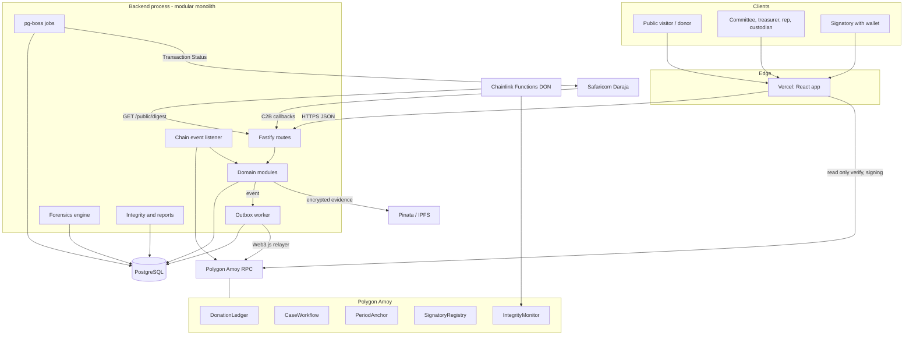
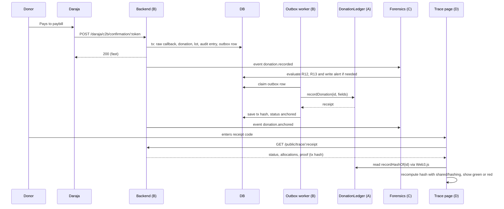
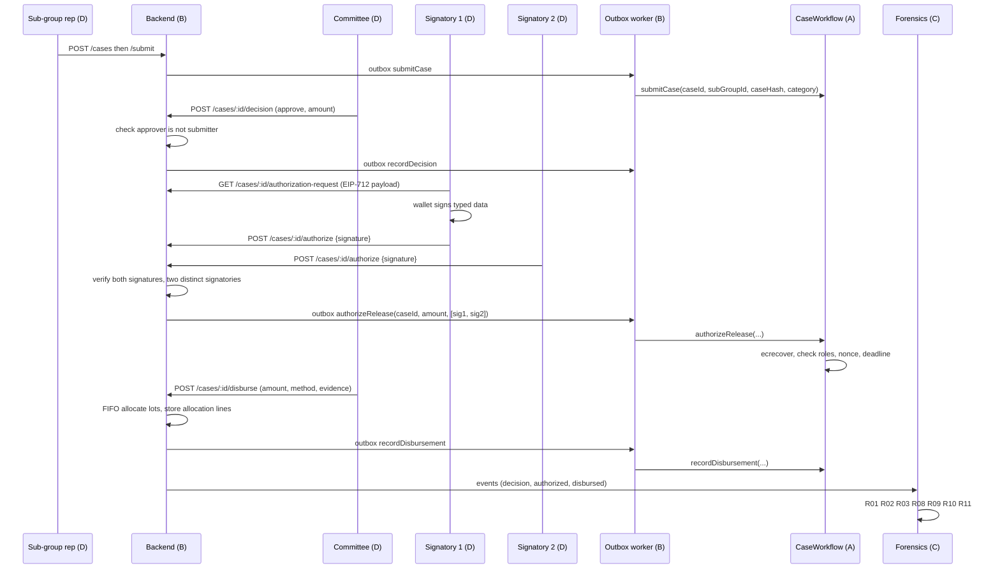
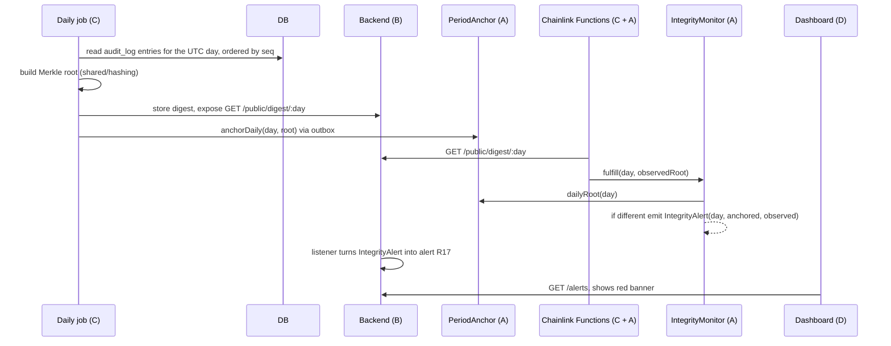
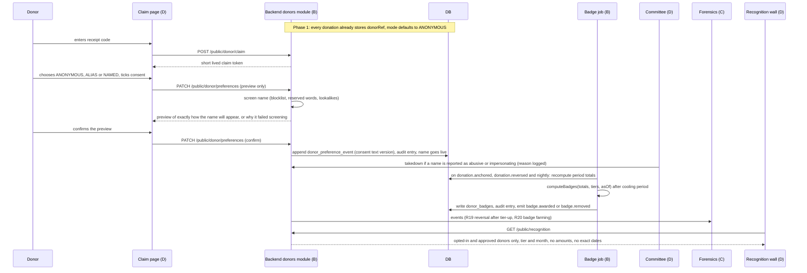
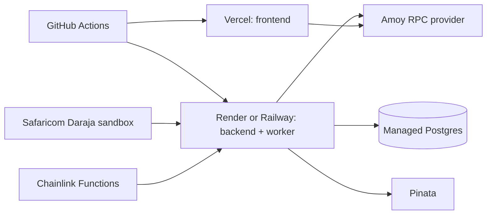

# CharityChain: Architecture and Integration Guide

This is the technical map every developer follows. The PRD (`fullPRD.md`) says what we build. This document says how the pieces fit together and what each track must provide to the others.

Read order for a new developer: this file, then `WORKFLOW.md`, then your own track guide (`guide-track-*.md`).

---

## 1. Principles

1. **Contract first.** Before anyone builds, the interfaces between tracks are written down and frozen: contract events and ABIs, the OpenAPI spec, the core database schema, the hashing spec. Building inside a track is free. Changing an interface is a team decision.
2. **Modular monolith.** One backend process with strict internal modules. No microservices. Fewer moving parts, easier to debug, easier to demo.
3. **The chain is a notary, not a bank.** Money never sits in a contract. Contracts store fingerprints, approvals and state transitions.
4. **One writer to the chain.** Only the backend relayer worker sends chain transactions. The browser signs approvals but never sends them.
5. **Async to the chain through an outbox.** A user action never waits for a block. The database write and the "anchor this" job are one transaction.
6. **Idempotent everything.** Daraja can repeat callbacks, workers can retry, users double click. Every write path has an idempotency key.
7. **Stubs so nobody waits.** Every cross-track dependency has a fake implementation for local work (section 8).
8. **Append only for money.** No UPDATE or DELETE on ledger tables. Corrections are new records.
9. **No personal data on-chain.** Hashes use a server-side keyed function. Nothing readable about donors or students is public.
10. **Money is integer minor units, time is UTC, ids are UUIDs.** No exceptions.

---

## 2. Repository layout and ownership

```
charitychain/
  frontend/                 Track D
    src/
      app/                  Router, providers, layouts, route guards
      features/             One folder per feature (see Track D guide)
      components/           Dumb, reusable UI
      lib/                  api client, web3 verify, i18n, money, hooks
      locales/              en.json, sw.json
      mocks/                MSW handlers generated from openapi.json
    e2e/                    Playwright specs (Track E reviews)
  backend/                  Tracks B and C
    prisma/                 schema.prisma, migrations, seed (B owns)
    src/
      modules/              B: auth, users, donations, daraja, bank, items,
                            inventory, cases, disbursements, evidence, public,
                            donors (profiles, preferences, badges, recognition)
      chain/                B: ChainClient, relayer, outbox worker, event listener
      jobs/                 B: pg-boss queues and schedules
      lib/                  B: crypto, ipfs, errors, logger, config, idempotency
      forensics/            C: rules, engine, scoring, graph
      integrity/            C: audit digest, merkle, daily anchor job
      reports/              C: quarterly report aggregator and PDF
      simulator/            C: scenarios, loader, evaluation
      server.ts
  blockchain/               Track A (functions/ is C with A)
    contracts/              Solidity sources, interfaces/, libraries/
    test/                   Hardhat tests, fuzz, vectors check
    scripts/                deploy, export-abis, verify
    functions/              Chainlink Functions JS sources
    deployments/            raw outputs (copied to shared/deployments)
  shared/                   Tech lead owns, changes need two reviews
    abis/                   Generated by A. TypeScript `as const` ABIs
    deployments/            local.json, amoy.json (addresses, blocks, version)
    openapi.json            Generated by B in CI. Never hand edited
    src/
      hashing/              idOf, hashDonation, hashCase, merkle, canonicalJson
      roles.ts              Role enum and permission map (one source for API and UI)
      events.ts             Domain event names and payload types
      errors.ts             Error code catalog
      money.ts              toMinor, fromMinor, formatKES
    vectors/                Golden test vectors (JSON) used by TS and Solidity tests
  infra/                    Track E: docker-compose, mock-daraja, scripts
  docs/                     Track E curates, everyone contributes
  .github/                  Track E: workflows, CODEOWNERS, templates
```

`pnpm-workspace.yaml` lists `frontend`, `backend`, `blockchain`, `shared`. Shared code is imported as `@charitychain/shared`.

---

## 3. System architecture

### 3.1 Runtime view



### 3.2 Backend internal layering

Every backend module follows the same shape so any dev can read any module.

```
modules/<name>/
  routes.ts      HTTP only: parse with Zod, call service, shape response
  service.ts     Business rules. Calls repo, other modules' public service API, emits events
  repo.ts        Prisma queries only. No business rules
  schema.ts      Zod request and response schemas (feed OpenAPI)
  events.ts      Domain events this module emits
  index.ts       Exports the module's public service interface (and nothing else)
  *.test.ts
```

Rules:

- A module never imports another module's `repo.ts`. It calls the other module's service interface.
- Every state change happens in a transaction that also writes an audit entry and, when needed, an outbox row. Use the `withAudit(tx, ...)` helper.
- `forensics/` and `integrity/` read through read-only views (section 6.3), not through other modules' repos.

### 3.3 Frontend layering

```
features/<name>/
  api.ts         Hooks wrapping the generated client (TanStack Query)
  components/    Feature specific components
  pages/         Route level components
  model.ts       View models and mappers (no fetch, no JSX)
  *.test.tsx
```

Business rules never live in components. The UI asks the backend. Role gating uses `shared/roles.ts`, the same map the backend enforces.

---

## 4. The five flows (who does what)

Track letters: **A** blockchain, **B** backend core, **C** forensics and integrity, **D** frontend.

### 4.1 Flow 1: M-Pesa donation



### 4.2 Flow 2: Case, approval, signing, disbursement



### 4.3 Flow 3: Bank deposit and item donation

1. **D** treasurer fills the bank deposit form. **B** stores it as `PENDING_VERIFICATION`, audit entry, no lot yet.
2. A different treasurer or committee member verifies in **D**. **B** checks `verifier != entered_by`, creates the lot, outbox row, anchors via **A**.
3. Foreign currency: **B** fetches the rate (from the Chainlink-fed value when available, otherwise a stored rate with its source), saves original and converted amounts.
4. Items: the pharmacy custodian logs an item in **D** (phone). **B** records it and the inventory movement. Item donations anchor with `Channel.IN_KIND`.
5. **C** runs R07 (statement reconciliation), R15 (stock shrinkage) on these events.

### 4.4 Flow 4: Daily integrity check



Fallback if Functions is not ready: a scheduled script in **C** posts the comparison result to `IntegrityMonitor` from the relayer account, and the README states Functions is the production path.

### 4.5 Flow 5: Quarterly close

1. Committee opens the report builder in **D**, picks the quarter, previews.
2. **B** `POST /reports/quarterly` calls **C** `reports.build(period)`.
3. **C** aggregates from the database into a canonical JSON object, computes `reportHash = keccak256(canonicalJson)`, renders the PDF (hash and QR printed on it), and returns both.
4. **B** stores the report row, enqueues `PeriodAnchor.anchorReport(year, quarter, reportHash, periodRoot)`.
5. **D** shows the verify link. Anyone can paste the hash or upload the JSON on the public verify page. **D** recomputes with `shared/hashing` and compares with the on-chain value.

### 4.6 Flow 6: Donor privacy and recognition (Phase 2, groundwork in Phase 1)

No new smart contract is needed. Donor identity and badges live off-chain. The chain already holds only the keyed donor reference.



Rules for this flow:

- `computeBadges` is a pure function in `backend/src/modules/donors/badges.ts` with no database or clock access, so it can be unit tested and recomputed for any past date.
- The recognition endpoint builds its response from an explicit allow list of fields. It never selects whole rows.
- The anonymous count is returned only when it is 5 or more.

---

## 5. Integration contracts between tracks

These six artifacts are the contract. They live in `shared/` or are generated into it.

### 5.1 Contract interface (A to B, D, C)

- Solidity interfaces in `blockchain/contracts/interfaces/`.
- On every merge to `main`, CI runs `pnpm --filter blockchain export-abis` which writes `shared/abis/*.ts` as `as const` arrays. Web3.js v4 infers types from them.
- Deployment manifest `shared/deployments/<network>.json`:

```json
{
  "network": "amoy",
  "chainId": 80002,
  "version": "0.3.1",
  "deployedAt": "2026-11-02T10:00:00Z",
  "contracts": {
    "DonationLedger": { "address": "0x...", "block": 123456 },
    "CaseWorkflow": { "address": "0x...", "block": 123457 },
    "PeriodAnchor": { "address": "0x...", "block": 123458 },
    "SignatoryRegistry": { "address": "0x...", "block": 123459 },
    "IntegrityMonitor": { "address": "0x...", "block": 123460 }
  },
  "abiHash": "0x..."
}
```

- CI fails if ABIs in `shared/abis` differ from a fresh build (drift check).

### 5.2 HTTP interface (B to D, C, E)

- Fastify with `fastify-type-provider-zod`, spec generated by `@fastify/swagger`.
- CI writes `shared/openapi.json` and fails if it differs from the committed file (drift check).
- D generates the typed client (`openapi-typescript`, `openapi-fetch`) and MSW mocks from it.
- Error shape for every failure:

```json
{ "error": { "code": "CASE_SELF_APPROVAL", "message": "Submitter cannot approve own case", "requestId": "..." } }
```

Codes live in `shared/src/errors.ts` as `MODULE_REASON`. Add codes there, never inline strings.

### 5.3 Database schema (B owns, C reads)

- Prisma schema in `backend/prisma/schema.prisma`. Only B edits it. Migrations are reviewed by C if a table C reads changes.
- C reads through views in a `forensics_read` schema (`v_donations`, `v_lots`, `v_cases`, `v_approvals`, `v_disbursements`, `v_allocations`, `v_audit`, `v_items`, `v_bank`, `v_donor_totals`). A read-only DB role `forensics_ro` is used by the forensics engine.
- C writes only to `alerts`, `alert_events`, `rules`, `reports`, `digests`.

### 5.4 Domain events (B to C and to itself)

Typed in `shared/src/events.ts`. Delivered in-process and persisted through pg-boss so consumers can retry.

| Event | Emitted by | Consumed by |
|---|---|---|
| `donation.recorded` | B donations, daraja | C, B outbox |
| `donation.anchored` | B chain | C |
| `donation.reversed` | B daraja, donations | C, B donors |
| `donor.preference.changed` | B donors | C, B recognition |
| `recognition.name.taken_down` | B recognition | C |
| `badge.awarded` / `badge.removed` | B donors | C, D via API |
| `bank.deposit.entered` / `bank.deposit.verified` | B bank | C |
| `item.logged` / `inventory.issued` | B items | C |
| `case.submitted` / `case.decided` | B cases | C |
| `case.signature.added` / `case.authorized` | B cases | C |
| `disbursement.recorded` | B disbursements | C |
| `alert.raised` / `alert.resolved` | C | B (notifications), D via API |
| `report.generated` / `report.anchored` | C, B | B |
| `chain.integrity_alert` | B listener | C (creates R17 alert) |

### 5.5 Canonical hashing spec v1 (A, B, C, D all depend on this)

This is the one place where four tracks must agree to the byte. Implemented once in `shared/src/hashing`, mirrored in Solidity where needed, and proven by golden vectors in `shared/vectors/*.json`. Both TypeScript and Hardhat tests load the same vectors.

- **Domain separated ids:** `idOf(kind, uuid) = keccak256(utf8("malkia:v1:" + kind + ":" + lowercaseUuid))`. Kinds: `donation`, `case`, `disbursement`, `report`.
- **Keyed reference hash:** `refHash(kind, value) = HMAC_SHA256(serverSecret, "malkia:v1:" + kind + ":" + value)` as bytes32. Used for M-Pesa codes, bank references and donor references. The secret never leaves the server, so these hashes cannot be brute forced from phone lists.
- **Donor reference:** `donorRef = refHash("donor", normalizedIdentity)`. The normalized identity is the phone in E.164 form (or the masked value Daraja returns, used as received if that is all we get), the lowercased email, or for bank deposits the normalized payer name plus a bank reference prefix. The same person giving by M-Pesa and by bank has two references until they link both receipts on the claim page.
- **Donation record hash:** `keccak256(abi.encode(bytes32 DOMAIN_DONATION_V1, bytes32 donationId, bytes32 sourceRefHash, bytes32 donorRef, uint64 amountMinor, bytes3 currency, uint8 channel, uint64 recordedAt, bytes32 evidenceHash))`.
- **Case hash:** `keccak256(abi.encode(DOMAIN_CASE_V1, caseId, subGroupId, needCategory, requestedAmountMinor, createdAt))`. Beneficiary identity is never part of it.
- **Canonical JSON:** RFC 8785 (JCS). Used for audit entries and report data.
- **Audit entry hash:** `entryHash = keccak256(prevHash || utf8(canonicalJson(entry)))` with `prevHash` of the first entry = 32 zero bytes. Each entry has a monotonically increasing `seq`.
- **Daily Merkle root:** leaves are `entryHash` values of that UTC day ordered by `seq`. Pair hashing is sorted (OpenZeppelin `MerkleProof` compatible). An empty day uses `keccak256(utf8("malkia:v1:empty-day:" + yyyymmdd))`.
- **Report hash:** `keccak256(utf8(canonicalJson(reportData)))`. The PDF is a rendering of that data and prints the hash.
- **Time:** unix seconds, UTC, `uint64`.
- **Money:** `uint64` minor units. KES 1.00 = 100. Items use currency `ITM` and quantity as the amount.
- **EIP-712 release authorization:** domain `{ name: "CharityChainCaseWorkflow", version: "1", chainId, verifyingContract }`, type `ReleaseAuthorization(bytes32 caseId,uint64 amountMinor,uint64 nonce,uint64 deadline)`.

Changing any line above is an interface change that needs a version bump (`v2`), new vectors, and a note in `docs/adr/`.

### 5.6 Roles and permissions (B and D)

`shared/src/roles.ts` exports the role enum and a permission map `can(role, action, resource)`. The backend guards use it. The frontend uses it to show or hide navigation. There is no second copy.

---

## 6. Data architecture

### 6.1 Storage map

| Data | Home | Why |
|---|---|---|
| Users, roles, cases, donations, lots, allocations | PostgreSQL | Relational, transactional |
| Audit log, case events, raw callbacks | PostgreSQL, append only | Triggers block UPDATE and DELETE |
| Fingerprints, approvals, state transitions | Polygon Amoy | Tamper evidence |
| Evidence files (encrypted) | IPFS via Pinata, CID in DB and on-chain | Large, immutable |
| Job queues | PostgreSQL via pg-boss | One less service |
| Secrets | Host secret store, `.env` locally | Never in git |

### 6.2 Outbox table (the heart of reliability)

```
outbox(
  id uuid pk, kind text, aggregate_id uuid, payload jsonb,
  idempotency_key text unique, status text,  -- PENDING, SENT, CONFIRMED, FAILED
  tx_hash text null, attempts int, next_attempt_at timestamptz, last_error text null,
  created_at timestamptz
)
```

Worker loop: claim `PENDING` rows with `FOR UPDATE SKIP LOCKED`, send, record `tx_hash`, wait for confirmations, set `CONFIRMED`. On restart it resumes. A reconcile job compares `CONFIRMED` rows to chain events nightly and raises an alert on any gap.

### 6.3 Forensics read model

Views in schema `forensics_read` expose only what rules need, with beneficiary identity columns excluded. This keeps C decoupled from B's table changes and keeps private data out of the analytics path.

---

## 7. Infrastructure

### 7.1 Environments

| Env | Chain | DB | Daraja | Purpose |
|---|---|---|---|---|
| local | Hardhat node on 8545 | Docker Postgres 5432 | mock-daraja on 4000 | Daily development |
| staging | Polygon Amoy | Managed Postgres | Daraja sandbox | Integration checkpoints, CI deploys from `main` |
| demo | Polygon Amoy (separate deployment) | Managed Postgres, seeded | Daraja sandbox | Lecturer demo, usability sessions |

### 7.2 Deployment view



The backend runs as one image with two process types: `web` (Fastify) and `worker` (outbox, jobs, forensics, integrity, listener). Same code, different command.

### 7.3 Local ports and commands

| Service | Port | Start |
|---|---|---|
| Frontend (Vite) | 5173 | `pnpm dev:web` |
| Backend API | 3001 | `pnpm dev:api` |
| Backend worker | n/a | `pnpm dev:worker` |
| Postgres | 5432 | `pnpm dev:infra` (docker compose) |
| Hardhat node | 8545 | `pnpm dev:chain` (node plus local deploy, writes `shared/deployments/local.json`) |
| mock-daraja | 4000 | started by `pnpm dev:infra` |
| Local IPFS (optional) | 5001 | profile `ipfs` in compose, otherwise a file based stub |

One command to bring everything up: `pnpm dev` (uses the above). `pnpm seed` loads a small simulator dataset. `pnpm test` runs all workspaces.

### 7.4 Environment variables (names only, values never committed)

```
# backend
DATABASE_URL, JWT_SECRET, JWT_REFRESH_SECRET, REF_HASH_SECRET, EVIDENCE_KEK
RPC_URL, CHAIN_ID, RELAYER_PRIVATE_KEY, CONFIRMATIONS
DARAJA_ENV, DARAJA_CONSUMER_KEY, DARAJA_CONSUMER_SECRET, DARAJA_SHORTCODE,
DARAJA_PASSKEY, DARAJA_CALLBACK_TOKEN, DARAJA_BASE_URL
PINATA_JWT, IPFS_MODE (pinata | local | stub)
FX_RATE_SOURCE_URL
# frontend
VITE_API_URL, VITE_CHAIN_ID, VITE_RPC_URL, VITE_EXPLORER_URL
# blockchain
DEPLOYER_PRIVATE_KEY, AMOY_RPC_URL, POLYGONSCAN_API_KEY
FUNCTIONS_SUBSCRIPTION_ID
```

---

## 8. Stubs and fakes (how tracks work without waiting)

| If you are | and you need | use this until it is ready |
|---|---|---|
| B | Contracts | `FakeChainClient` (in-memory, same `ChainClient` interface) or Hardhat node with A's interfaces |
| B | Daraja | `infra/mock-daraja` that posts realistic C2B payloads, including duplicates and late callbacks |
| B | IPFS | `IPFS_MODE=stub` writes to `.data/ipfs` and returns a fake CID |
| C | Live data | Simulator output loaded into a local DB, or pure unit tests over `LedgerSnapshot` fixtures |
| D | Backend | MSW handlers generated from `shared/openapi.json`, plus `/mocks/scenarios` for loading, empty, error and alert states |
| D | Chain | Hardhat node with `pnpm dev:chain` and a funded test signatory account |
| A | Backend | Nobody. A is independent. Tests and scripts are enough |
| E | Anything | Own the stubs listed above and keep them current |

The interface that makes B independent of A:

```ts
// backend/src/chain/ChainClient.ts
export interface ChainClient {
  recordDonation(input: DonationAnchorInput): Promise<TxRef>;
  submitCase(input: CaseAnchorInput): Promise<TxRef>;
  recordDecision(input: DecisionAnchorInput): Promise<TxRef>;
  authorizeRelease(input: { caseId: Hex; amountMinor: bigint; signatures: Hex[] }): Promise<TxRef>;
  recordDisbursement(input: DisbursementAnchorInput): Promise<TxRef>;
  anchorDaily(day: number, root: Hex): Promise<TxRef>;
  anchorReport(year: number, quarter: number, reportHash: Hex, periodRoot: Hex): Promise<TxRef>;
  getReceipt(txHash: Hex): Promise<TxStatus>;
  onEvent(handler: (e: ChainEvent) => Promise<void>): Unsubscribe;
}
```

`Web3ChainClient` and `FakeChainClient` both implement it. Tests pick one by config.

---

## 9. Security responsibilities by track

| Track | Must do |
|---|---|
| A | Access control on every external function, custom errors, replay protection, Slither clean, no loops over unbounded data, tests for every revert |
| B | Auth and 2FA, RBAC from `shared/roles`, segregation of duties in services, Daraja callback hardening, input validation with Zod, rate limits, encryption of evidence and beneficiary identity, secrets handling, no PII in logs |
| C | Read-only DB role, no beneficiary identity in analytics views, deterministic hashing, rules cannot be edited without audit |
| D | No tokens in localStorage (access token in memory, refresh token in httpOnly cookie), output encoding, CSP friendly code, no private data on public pages, wallet prompts show exactly what is being signed |
| E | Secret scanning, dependency audit, branch protection, least privilege for CI tokens, key rotation runbooks, backup of Postgres |

---

## 10. Integration checkpoints

Every two weeks the whole team merges to `main`, runs the end to end scenario, and demos it. Interfaces are frozen at IC0. Anything that does not work at a checkpoint becomes the top task of the next sprint.

| Checkpoint | Target week | Scenario that must work | Needs |
|---|---|---|---|
| **IC0: interfaces frozen** | 1 | Nothing runs yet. Everything is written down | A: interface files and event list. B: OpenAPI skeleton and core Prisma schema. C: Rule and snapshot types. D: design tokens and route map. Shared: hashing spec with vectors. E: CI and `pnpm dev` working |
| **IC1: first donation** | 3 | Mock Daraja callback creates a donation, the outbox anchors it on the local chain, the trace page shows it and the browser verify turns green | A: DonationLedger. B: daraja, donations, outbox, public trace. D: trace page. E: compose and mock-daraja |
| **IC2: case to payout** | 5 | Rep submits, committee approves, two signatories sign in the browser, disbursement is recorded, donor trace shows the allocation | A: CaseWorkflow and registry. B: cases, disbursements, FIFO. D: case screens and signing |
| **IC3: alerts and dashboard** | 7 | Simulator loads a year of data with injected fraud, alerts appear in the inbox, dashboard and graph work, daily anchor runs | C: rules, simulator, digest. D: dashboard and alert screens. B: reconcile and listener |
| **IC4: demo candidate** | 9 | Everything above on Amoy, quarterly report anchored, Chainlink check (or fallback) running, security review done | All tracks. E runs the demo script and the evaluation protocol |

---

## 11. Architecture decision records

Decisions that need discussion go in `docs/adr/NNNN-title.md` using this template:

```
# NNNN Title
Status: proposed | accepted | superseded by NNNN
Context: what forces are in play
Decision: what we chose
Consequences: what gets easier, what gets harder
```

Initial ADRs to write at IC0: 0001 modular monolith, 0002 off-chain money and on-chain notary, 0003 outbox pattern, 0004 hashing spec v1, 0005 lot allocation FIFO, 0006 2-of-3 EIP-712 release, 0007 evidence encryption, 0008 Chainlink Functions plus fallback, 0009 pseudonymous donor identity and off-chain badges.
