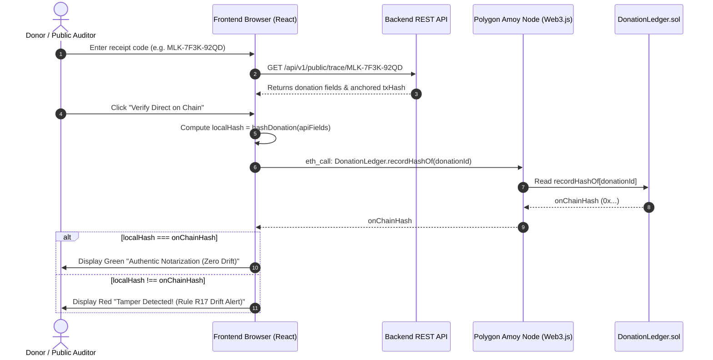

# CharityChain Canonical Hashing Specification (v1)

> **Status:** Frozen at Integration Checkpoint 0 (IC0)  
> **Applies to:** Track A (Blockchain), Track B (Backend Core), Track C (Forensics & Integrity), Track D (Frontend)  
> **Source of Truth:** `docs/ARCHITECTURE.md` §5.5

---

## 1. Overview & Purpose

CharityChain operates as an **off-chain financial system anchored by an on-chain cryptographic notary**. 
To ensure zero drift across the entire platform:
- The **Backend** computes record hashes when inserting donations, cases, and audit logs.
- The **Smart Contracts** on Polygon Amoy store and assert these hashes immutably.
- The **Frontend** independently reads the smart contracts via Web3.js and recomputes hashes in the user's browser to prove data authenticity without trusting the backend server.
- The **Forensics & Integrity Engine** digests audit trails into daily Merkle roots and reports.

Every component must serialize data to the **exact byte**. A single difference in padding, endianness, character casing, or field ordering will produce mismatched hashes and trigger **Rule R17 (Integrity Alert)**.

---

## 2. Cryptographic Constants & Domain Separators

Domain separators guarantee that hashes computed for one domain cannot collide or be replayed in another.

| Constant | Definition | Value (Hex) |
|---|---|---|
| `DOMAIN_DONATION_V1` | `keccak256("malkia:v1:donation")` | `0x380b31d3f6b995e439475b0533feb329dcf8d46c63268ef1539d8bc150c39f20` |
| `DOMAIN_CASE_V1` | `keccak256("malkia:v1:case")` | `0x061ba715bc50d2e060da0a96ec332a625a575d561ddf8ac59a8bbb3759c675bb` |
| `RELEASE_AUTH_TYPE` | `"ReleaseAuthorization(bytes32 caseId,uint64 amountMinor,uint64 nonce,uint64 deadline)"` | String literal |
| `RELEASE_AUTH_TYPEHASH` | `keccak256(RELEASE_AUTH_TYPE)` | `0x51395a7908f7e40ceeb99ab96b3b0d137d6cd6f5e431de44a8d60de550fda838` |
| `EIP712_DOMAIN_TYPE` | `"EIP712Domain(string name,string version,uint256 chainId,address verifyingContract)"` | String literal |
| `EIP712_DOMAIN_TYPEHASH`| `keccak256(EIP712_DOMAIN_TYPE)` | `0x8b73c3c69bb8fe3d512ecc4cf759cc79239f7b179b0ffacaa9a75d522b39400f` |

---

## 3. The 7 Canonical Hashing Specifications

### 3.1 Domain-Separated Identifiers (`idOf`)
Translates entity UUIDs into standardized `bytes32` keys for smart contract storage.

* **Formula:**
  $$\text{idOf}(\text{kind}, \text{uuid}) = \text{keccak256}(\text{utf8}(\text{"malkia:v1:"} + \text{kind} + \text{":"} + \text{lowercaseUuid}))$$
* **Allowed `kind` strings:** `donation`, `case`, `disbursement`, `report`.
* **UUID format:** Lowercase hexadecimal with hyphens (RFC 4122), e.g. `d1a2b3c4-0000-0000-0000-000000000001`.

```typescript
// TypeScript (Frontend / Backend)
export function idOf(kind: 'donation' | 'case' | 'disbursement' | 'report', uuid: string): string {
  return web3.utils.keccak256(`malkia:v1:${kind}:${uuid.toLowerCase()}`);
}
```

---

### 3.2 Keyed Reference Hashes (`refHash` & `donorRef`)
Protects sensitive PII (donor phone numbers, national IDs, M-Pesa transaction codes, bank accounts) against rainbow table and brute-force attacks.

* **Formula:**
  $$\text{refHash}(\text{kind}, \text{value}) = \text{HMAC-SHA256}(\text{serverSecret}, \text{"malkia:v1:"} + \text{kind} + \text{":"} + \text{value}) \rightarrow \text{bytes32}$$
* **Donor Reference:**
  $$\text{donorRef} = \text{refHash}(\text{"donor"}, \text{normalizedIdentity})$$
* **Normalization rules:**
  - Phone numbers: strict E.164 (e.g., `+254712345678`) or the masked string from Daraja if received masked.
  - Emails: trimmed and lowercased.
  - Bank deposits: `BANK:<bankCode>:<cleanAccountOrRef>`.
* **Security guarantee:** `serverSecret` never leaves the backend environment. Hashes stored on-chain or sent to the browser cannot be reversed without the secret.

```typescript
// Backend only (Node.js)
import crypto from 'node:crypto';

export function refHash(serverSecret: string, kind: string, value: string): string {
  const hmac = crypto.createHmac('sha256', serverSecret);
  hmac.update(`malkia:v1:${kind}:${value}`);
  return '0x' + hmac.digest('hex');
}
```

---

### 3.3 Donation Record Hash (`hashDonation`)
The cryptographic fingerprint anchored in `DonationLedger.sol` and verified on the public `/trace` page.

* **Solidity Definition:**
  ```solidity
  keccak256(
      abi.encode(
          DOMAIN_DONATION_V1,
          donationId,
          sourceRefHash,
          donorRef,
          amountMinor,
          currency,
          channel,
          recordedAt,
          evidenceHash
      )
  )
  ```
* **ABI Encoding Layout (576 bytes / 9 EVM 32-byte words):**
  1. `bytes32 DOMAIN_DONATION_V1`: `0x380b31...` (32 bytes)
  2. `bytes32 donationId`: `bytes32` (32 bytes)
  3. `bytes32 sourceRefHash`: `bytes32` (32 bytes)
  4. `bytes32 donorRef`: `bytes32` (32 bytes)
  5. `uint64 amountMinor`: Minor units (e.g. KES 500.00 = `50000`). Big-endian right-aligned in 32 bytes (24 zero bytes prefix).
  6. `bytes3 currency`: 3 ASCII chars (e.g. `"KES"` = `0x4b4553`). Left-aligned in 32 bytes (29 zero bytes suffix).
  7. `uint8 channel`: `0` for MPESA, `1` for BANK, `2` for IN_KIND. Right-aligned in 32 bytes (31 zero bytes prefix).
  8. `uint64 recordedAt`: UTC Unix timestamp in seconds. Right-aligned in 32 bytes.
  9. `bytes32 evidenceHash`: `keccak256` of plaintext evidence file (or 32 zero bytes if none).

* **Isomorphic TypeScript Implementation (Frontend & Backend):**
```typescript
import { Web3 } from 'web3';

export interface DonationRecordData {
  donationId: string;       // bytes32 hex
  sourceRefHash: string;    // bytes32 hex
  donorRef: string;         // bytes32 hex
  amountMinor: bigint | number;
  currency: string;         // 'KES', 'USD', 'ITM' (max 3 chars)
  channel: 0 | 1 | 2;       // 0: MPESA, 1: BANK, 2: IN_KIND
  recordedAt: bigint | number;
  evidenceHash?: string;    // bytes32 hex (defaults to 32 zero bytes)
}

export function hashDonation(web3: Web3, d: DonationRecordData): string {
  const DOMAIN_DONATION_V1 = '0x380b31d3f6b995e439475b0533feb329dcf8d46c63268ef1539d8bc150c39f20';
  const evidenceHash = d.evidenceHash || '0x' + '00'.repeat(32);

  const encoded = web3.eth.abi.encodeParameters(
    ['bytes32', 'bytes32', 'bytes32', 'bytes32', 'uint64', 'bytes3', 'uint8', 'uint64', 'bytes32'],
    [
      DOMAIN_DONATION_V1,
      d.donationId,
      d.sourceRefHash,
      d.donorRef,
      d.amountMinor.toString(),
      web3.utils.utf8ToHex(d.currency),
      d.channel,
      d.recordedAt.toString(),
      evidenceHash
    ]
  );

  return web3.utils.keccak256(encoded);
}
```

---

### 3.4 Case Hash (`hashCase`)
Represents an approved student assistance case without exposing student identity.

* **Solidity Definition:**
  ```solidity
  keccak256(
      abi.encode(
          DOMAIN_CASE_V1,
          caseId,
          subGroupId,
          needCategory,
          requestedAmountMinor,
          createdAt
      )
  )
  ```
* **ABI Layout (192 bytes / 6 EVM 32-byte words):**
  1. `bytes32 DOMAIN_CASE_V1`: `0x061ba7...`
  2. `bytes32 caseId`
  3. `bytes32 subGroupId`
  4. `bytes3 needCategory`: Left-aligned ASCII, e.g. `"FEE"`, `"BOK"`, `"MED"`
  5. `uint64 requestedAmountMinor`: Right-aligned
  6. `uint64 createdAt`: UTC Unix timestamp in seconds

---

### 3.5 Canonical JSON (RFC 8785) & Audit Entry Hash
All audit logs and transparency reports are serialized into deterministic JSON (RFC 8785 / JCS) before hashing.

* **RFC 8785 Serialization Rules:**
  - Keys sorted by UTF-16 code units (lexicographical).
  - No whitespace between tokens (no spaces after colons or commas).
  - Numbers formatted standard ECMAScript representation.
  - UTF-8 encoding without BOM.
* **Audit Chain Formula:**
  $$\text{entryHash} = \text{keccak256}(\text{prevHash} \mathbin{\Vert} \text{utf8}(\text{canonicalJson}(\text{entry})))$$
  - First entry (genesis): `prevHash` = 32 zero bytes (`0x00...00`).
  - `entry.seq` strictly increases (`1, 2, 3, ...`).

```typescript
export function canonicalJson(obj: unknown): string {
  if (obj === null || typeof obj !== 'object') {
    return JSON.stringify(obj);
  }
  if (Array.isArray(obj)) {
    return '[' + obj.map(canonicalJson).join(',') + ']';
  }
  const keys = Object.keys(obj as Record<string, unknown>).sort();
  const pairs = keys.map((key) => JSON.stringify(key) + ':' + canonicalJson((obj as Record<string, unknown>)[key]));
  return '{' + pairs.join(',') + '}';
}

export function hashAuditEntry(web3: Web3, prevHash: string, entryData: object): string {
  const jsonBytes = web3.utils.utf8ToHex(canonicalJson(entryData));
  const packed = web3.utils.encodePacked(
    { value: prevHash, type: 'bytes32' },
    { value: jsonBytes, type: 'bytes' }
  );
  return web3.utils.keccak256(packed!);
}
```

---

### 3.6 Daily Merkle Root
Daily aggregation of all audit log `entryHash` values anchored into `PeriodAnchor.sol`.

* **Pair Hashing (OpenZeppelin `MerkleProof` compatible):**
  $$\text{hashPair}(a, b) = \begin{cases} 
  \text{keccak256}(a \mathbin{\Vert} b) & \text{if } a < b \\
  \text{keccak256}(b \mathbin{\Vert} a) & \text{otherwise}
  \end{cases}$$
  *Comparison is numerical big-endian on the 32-byte values (`a.toLowerCase() <= b.toLowerCase()` in hex).*
* **Empty Day Fallback:**
  $$\text{emptyRoot}(yyyymmdd) = \text{keccak256}(\text{utf8}(\text{"malkia:v1:empty-day:"} + yyyymmdd))$$

```typescript
export function hashMerklePair(web3: Web3, a: string, b: string): string {
  const aNorm = a.toLowerCase();
  const bNorm = b.toLowerCase();
  const sorted = aNorm <= bNorm ? aNorm + bNorm.slice(2) : bNorm + aNorm.slice(2);
  return web3.utils.keccak256(sorted);
}

export function computeDailyMerkleRoot(web3: Web3, entryHashes: string[], yyyymmdd: string): string {
  if (entryHashes.length === 0) {
    return web3.utils.keccak256(`malkia:v1:empty-day:${yyyymmdd}`);
  }
  let currentLevel = [...entryHashes];
  while (currentLevel.length > 1) {
    const nextLevel: string[] = [];
    for (let i = 0; i < currentLevel.length; i += 2) {
      if (i + 1 < currentLevel.length) {
        nextLevel.push(hashMerklePair(web3, currentLevel[i], currentLevel[i + 1]));
      } else {
        // Carry odd leaf up to the next level
        nextLevel.push(currentLevel[i]);
      }
    }
    currentLevel = nextLevel;
  }
  return currentLevel[0];
}
```

---

### 3.7 EIP-712 Release Authorization Digest
Used by committee members to cryptographically co-sign disbursements (2-of-3 threshold).

* **Domain Data:**
  - `name`: `"CharityChainCaseWorkflow"`
  - `version`: `"1"`
  - `chainId`: `80002` (Polygon Amoy)
  - `verifyingContract`: Address of deployed `CaseWorkflow`
* **Typed Struct:**
  ```
  ReleaseAuthorization(bytes32 caseId,uint64 amountMinor,uint64 nonce,uint64 deadline)
  ```
* **Digest Generation:**
  $$\text{digest} = \text{keccak256}(\text{"\x19\x01"} \mathbin{\Vert} \text{domainSeparator} \mathbin{\Vert} \text{structHash})$$

---

## 4. How the Frontend Performs Independent Verification

On the frontend `/trace` page (`TracePage.tsx`), clicking **Verify Direct on Chain** executes:



---

## 5. Golden Test Vector Reference

Use these vectors to validate your test suites across TypeScript, Node.js, and Solidity.

### Vector 1: `DOMAIN_DONATION_V1`
* **Input:** `"malkia:v1:donation"`
* **Expected Hash:** `0x380b31d3f6b995e439475b0533feb329dcf8d46c63268ef1539d8bc150c39f20`

### Vector 2: `DOMAIN_CASE_V1`
* **Input:** `"malkia:v1:case"`
* **Expected Hash:** `0x061ba715bc50d2e060da0a96ec332a625a575d561ddf8ac59a8bbb3759c675bb`

### Vector 3: `idOf`
* **Input:** `kind = "donation"`, `uuid = "d1a2b3c4-0000-0000-0000-000000000001"`
* **Pre-image:** `"malkia:v1:donation:d1a2b3c4-0000-0000-0000-000000000001"`
* **Expected Hash:** `0xc6c7eae886c7a49306015a5d23f82efc9b95323141a50401017019e5bbd7b734`

### Vector 4: `hashDonation`
* **Inputs:**
  - `donationId`: `0x1111111111111111111111111111111111111111111111111111111111111111`
  - `sourceRefHash`: `0x2222222222222222222222222222222222222222222222222222222222222222`
  - `donorRef`: `0x3333333333333333333333333333333333333333333333333333333333333333`
  - `amountMinor`: `50000` (KES 500.00)
  - `currency`: `"KES"`
  - `channel`: `0` (MPESA)
  - `recordedAt`: `1728894190`
  - `evidenceHash`: `0x0000000000000000000000000000000000000000000000000000000000000000`
* **Expected Record Hash:**
  `0x99c0f01d1fe499a124d122d6f25dda85826509f5b3123ff065ab9681dd4243da`

### Vector 5: `hashEmptyDay`
* **Input:** `"20261102"`
* **Pre-image:** `"malkia:v1:empty-day:20261102"`
* **Expected Hash:** `0xb01bb4f26f21a81c20b6bd9afa0a0ed4c3956c71296fdcecb950b82cb519c9bc`
