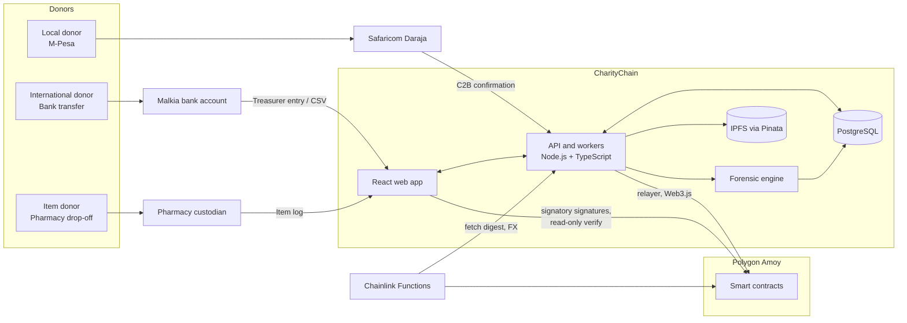
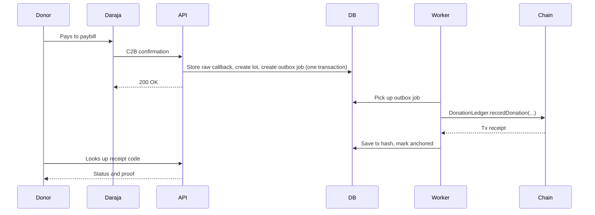
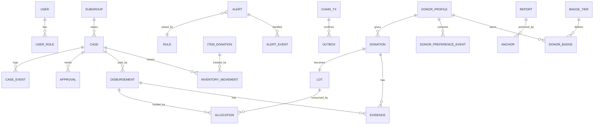
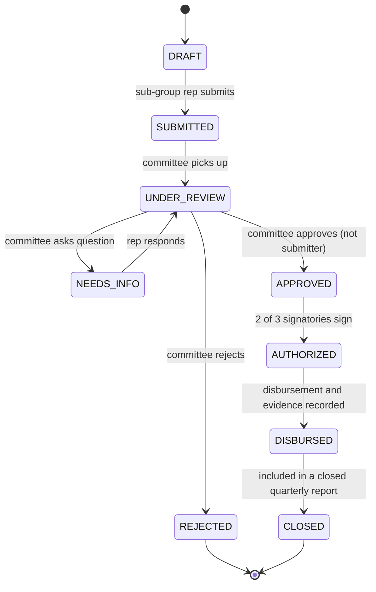

# CharityChain: Product Requirements Document

**Project:** CharityChain, a blockchain-based donation tracking system with forensic fund flow analysis
**Client organization:** Malkia (registered campus charity group, students and staff)
**Course:** CCS 3353, Group 2
**Repo:** `charitychain/` (monorepo: `frontend/`, `backend/`, `blockchain/`, `shared/`, `docs/`)
**Status:** Draft v0.2 (adds team tracks in section 24, see also `docs/ARCHITECTURE.md`)
**Owners:** Team leads (Group 2)

---

## 1. Summary

Malkia collects money and items from donors around the world and passes them to needy students on campus. Today nothing is recorded. A donor sends money and has to trust that it was used well. The committee, in turn, cannot prove its own good conduct if anyone ever asks.

CharityChain gives Malkia a single record of everything: every donation that comes in (M-Pesa, bank, physical items), every case raised by a sub-group, every approval, every disbursement, and the evidence behind it. The record is anchored on a public blockchain so nobody, including us, can quietly edit history. Donors check their own donation with a receipt code, no wallet needed. A forensic engine watches the fund flow and raises alerts when something looks wrong.

The core idea in one line: **the money stays on the rails people already trust (M-Pesa and the bank), and the blockchain becomes the tamper-proof notebook that sits behind them.**

---

## 2. Context and problem

### 2.1 How Malkia works today

| Topic | Fact (from Malkia's reply to our supervisor) |
|---|---|
| Status | Registered charity group, students and staff together |
| Collection channels | Bank account, M-Pesa paybill, physical items dropped at the university hospital pharmacy |
| Timing | Continuous, all year, no fixed collection window |
| Donors | From all over the world, not only Kenya |
| Identifying beneficiaries | Needy students are identified inside smaller official sub-groups, then forwarded to the main committee |
| Decisions | Main committee decides amounts and items, case by case |
| Account control | Three signatories, all members of the Executive Committee |
| Reporting | Committee reports to full membership at quarterly meetings in the semester |
| Existing records | None |

### 2.2 Problem

1. Donors cannot verify what happened to their contribution.
2. The committee cannot produce an auditable account of its own work.
3. Three channels (one digital, one bank, one physical) mean no single view of what came in.
4. Existing blockchain donation systems assume donors hold crypto wallets. Malkia donors do not.

### 2.3 Why a blockchain at all

Fair question, and the panel will ask it. The honest answer:

- A normal database can be edited by whoever has admin access. A donor trusting a database is still trusting a person.
- Anchoring records on a public chain means any later edit is detectable by anyone, without trusting us or the committee.
- Malkia's own governance (three signatories) maps cleanly onto multi-signature approval, which blockchains do natively and verifiably.

What the blockchain does **not** do here: hold money. No funds ever sit in a smart contract. Contracts store records, approvals and fingerprints. This is a deliberate decision (see D1).

---

## 3. Goals, non-goals, success metrics

### 3.1 Goals

- G1. Capture every donation from all three channels into one ledger.
- G2. Let any donor trace their own donation from receipt to use, without a wallet.
- G3. Model Malkia's real workflow: sub-group case, committee decision, signatory release, disbursement, quarterly report.
- G4. Make tampering detectable by anyone, using on-chain anchoring.
- G5. Detect suspicious fund flows automatically and keep a record of how each alert was handled.
- G6. Generate the quarterly report in one click, with a verifiable fingerprint.
- G7. Let donors choose how they are shown publicly (anonymous by default) and recognize generous and consistent donors with badges, without exposing anyone who prefers privacy.

### 3.2 Non-goals (for this project)

- Holding or moving real money on-chain.
- Replacing M-Pesa or the bank as payment rails.
- Accepting cryptocurrency donations (listed as a stretch idea only).
- Mainnet deployment. We run on a testnet.
- Handling Malkia's real money in production. Our evaluation uses the Daraja sandbox and seeded data unless Malkia agrees otherwise in writing.
- Full accounting software. We record donations and disbursements, not payroll or tax.

### 3.3 Success metrics

These double as our evaluation plan for Objective v.

| Metric | Target |
|---|---|
| Donation captured in ledger after M-Pesa confirmation | p95 under 30 seconds |
| Donation visible on trace page after capture | p95 under 60 seconds including chain anchoring |
| Donors who complete "trace my donation" unaided | 90 percent or more in usability test |
| Committee usability score (SUS) | 70 or higher |
| Seeded fraud scenarios detected by forensic engine | recall 90 percent or more, precision 70 percent or more |
| Time to produce a quarterly report | under 5 minutes, down from "unknown, manual" |
| On-chain contract test coverage | 90 percent or more lines, 100 percent of fund approval paths |
| Critical or high findings left open in Slither at release | 0 |

---

## 4. Users and roles

### 4.1 Personas

| Persona | Who they are | What they want |
|---|---|---|
| Donor (local) | Student, staff or well-wisher giving by M-Pesa | "Show me my KES 500 did something." No signup, no wallet. Decides if and how they are shown publicly. |
| Donor (international) | Alumni or well-wisher giving by bank transfer | Same, plus a clear receipt they can keep for their records. |
| Sub-group representative | Student leader inside a sub-group | Raise a case for a needy student quickly and privately. |
| Committee member | Main group committee | Review cases, decide amounts, record disbursements, produce reports. |
| Signatory | One of three Executive Committee members on the account | Approve fund release. Two of three must agree. |
| Treasurer or records officer | Committee member handling bank and item records | Enter bank deposits and item receipts, reconcile statements. |
| Pharmacy custodian | Person receiving physical items at the university hospital pharmacy | Log items quickly on a phone when they arrive. |
| Member or auditor | Any Malkia member, or an external auditor | Read-only view of everything except private beneficiary details. |
| System admin | Our team during the project | Manage users, keys, deployments. Cannot approve money or edit records. |

### 4.2 Permission matrix

`C` create, `R` read, `U` update, `A` approve, `-` none. All writes are logged.

| Resource | Donor | Sub-group rep | Committee | Treasurer | Signatory | Pharmacy custodian | Member/Auditor | Sys admin |
|---|---|---|---|---|---|---|---|---|
| Own donation trace | R | - | R | R | R | - | R | - |
| Public dashboard | R | R | R | R | R | R | R | R |
| Case (own sub-group) | - | C, R, U (draft) | R | R | R | - | R (redacted) | - |
| Case decision | - | - | A | - | - | - | - | - |
| Release authorization | - | - | - | - | A (2 of 3) | - | - | - |
| Disbursement record | - | - | C, R | C, R | R | - | R | - |
| Bank deposit entry | - | - | R | C, U | R | - | R | - |
| Bank deposit verification | - | - | - | A (different person from entry) | - | - | - | - |
| In-kind item log | - | - | R | R | R | C, U | R | - |
| Forensic alerts | - | - | R, U (resolve) | R | R | - | R | - |
| Own display preference and badge | C, R, U | - | - | - | - | - | - | - |
| Public name (alias or named) | A (own, after previewing) | - | R, takedown if abusive | - | - | - | R | - |
| Badge tier thresholds | - | - | C, U (second committee approval needed) | - | - | - | R | - |
| Donor identity in admin screens | - | - | R (masked, reveal logged) | R (masked, reveal logged) | R (masked, reveal logged) | - | R (masked) | - |
| User and role admin | - | - | - | - | - | - | - | C, U |

Segregation of duties is enforced in code, not by policy: the person who submits a case cannot approve it, the person who enters a bank deposit cannot verify it, and a signatory cannot be the only approver of their own disbursement.

---

## 5. Key design decisions

Short records of the choices that shape everything else. Change these only with the whole team.

**D1. Money stays off-chain. The chain is a notarized ledger.**
Funds move through M-Pesa and the bank. Smart contracts record events, approvals and fingerprints. This matches how Malkia works, avoids custody risk, and is honest about what blockchain adds (tamper evidence and verifiable approvals, not payment).

**D2. Donors never touch a wallet.**
A backend relayer account signs chain writes. Donors get a receipt code. Internal users who must sign approvals (the three signatories) use wallets, because they are three known people and signing is the whole point of their role.

**D3. No personal data on-chain, ever.**
Chains are permanent and public. We store salted or keyed hashes of references, amounts, categories and timestamps, never phone numbers, names or beneficiary identities.

**D4. Pooled money is traced with a lot allocation model.**
Donations go into one pool, so "where did my money go" needs a rule. Each donation becomes a lot. Disbursements consume lots in first-in-first-out order unless a donor earmarked their gift. The result: a donation page can say "KES 300 of your KES 500 funded case C-0142 on 12 March." This model is also the backbone of the fund flow graph used by the forensic engine.

**D5. Release authorization is 2-of-3 signatures, verified by the contract.**
Mirrors Malkia's three-signatory control. Signatories sign an EIP-712 typed message in the browser. The contract checks two distinct valid signatories before it marks a disbursement authorized.

**D6. Backend writes to chain through an outbox.**
Database change and "please anchor this" job are saved in one transaction. A worker sends the chain transaction, retries on failure, and confirms. The system never loses an anchor and never anchors twice (idempotency keys).

**D7. Chainlink has a real job.**
Chainlink Functions independently fetches our published daily ledger digest and the contract compares it to the digest we anchored. If our database was edited after anchoring, the mismatch raises an on-chain integrity alert. Chainlink also supplies exchange rates for foreign donations. See section 9.5.

**D8. Evidence files are encrypted before they go to IPFS.**
IPFS is public. Receipts and photos can reveal students. Files are encrypted client-side or in the API before pinning. The chain stores the CID plus a hash of the plaintext. Only items marked public (for example a photo of donated textbooks with no people in it) skip encryption.

**D9. Donors are pseudonymous by default, and badges are computed off-chain.**
Each donor is a keyed hash reference, never a name. Public display is opt in (anonymous, alias or named) and anonymous is the default. Badges are a deterministic function of verified donations, so they can be recomputed and audited, and every award goes into the audit log. They stay off-chain because putting them on-chain would link identities and need wallets donors do not have. Recognition never changes who gets help.

---

## 6. Scope by phase

### Phase 1: MVP (must ship, this is the graded core)

- Daraja C2B integration (sandbox) writing donations to ledger
- Manual bank deposit entry with maker-checker verification
- In-kind item log (phone friendly)
- Case workflow: sub-group submit, committee decide, 2-of-3 signatory release, disbursement with evidence
- Smart contracts on Polygon Amoy: DonationLedger, CaseWorkflow, PeriodAnchor
- Public donor trace page and public transparency dashboard
- Core forensic rules (at least 8) and alert inbox
- Quarterly report generation with anchored fingerprint
- IPFS evidence storage
- React web app, role based
- Donor reference and consent data stored from day one, default display mode anonymous (groundwork for Phase 2 recognition)

### Phase 2: Strong version (should ship)

- Chainlink Functions integrity monitor and FX conversion
- Bank statement CSV import with automatic reconciliation
- Lot allocation visualization (Sankey) per donation
- Forensic graph view and statistical checks (Benford, outliers)
- Fraud scenario simulator with ground truth, used for precision and recall evaluation
- Swahili and English UI
- Donor email or SMS receipt
- Donor claim page and display choices (anonymous, alias, named), where the donor previews and confirms their own public name, with automatic name screening and committee takedown
- Badge tiers (bronze, silver, gold, lifetime patron) and a consistent giver badge
- Public recognition wall with inference protection

### Phase 3: Stretch (nice to have)

- Android app for the pharmacy custodian and committee (Kotlin, offline-first item logging)
- Testnet stablecoin donation channel to show how diaspora giving could work
- Merkle proof "verify in your browser" tool
- Chainlink Automation for scheduled integrity checks and period close
- Public read-only API for external auditors

---

## 7. Functional requirements

IDs are stable. Tests and tickets reference them.

### 7.1 Donation intake

- **FR-INT-01** The system registers C2B validation and confirmation URLs with Daraja and accepts confirmations for Malkia's paybill.
- **FR-INT-02** Every callback is stored raw (immutable) before processing, then parsed into a donation lot.
- **FR-INT-03** Callbacks are idempotent on the M-Pesa transaction ID. A replayed callback never creates a second donation.
- **FR-INT-04** Callback endpoints reject requests that fail source checks (secret path token and, where possible, Safaricom IP allowlist).
- **FR-INT-05** A scheduled job calls the Daraja Transaction Status API for any confirmation that looks incomplete and raises an alert on mismatch.
- **FR-INT-06** The treasurer can enter a bank deposit (date, amount, currency, bank reference, optional donor label). A second user must verify it before it counts.
- **FR-INT-07** Bank statement CSV import proposes matches against entered deposits and flags unmatched lines both ways. (Phase 2)
- **FR-INT-08** The pharmacy custodian can log an item donation: category, quantity, condition, optional estimated value, photo, donor label. Works on a phone browser with a poor connection.
- **FR-INT-09** Foreign currency deposits store the original amount, currency, rate source and converted KES value.
- **FR-INT-10** Each donation gets a human friendly receipt code (for example `MLK-7F3K-92QD`). M-Pesa donors can also use their M-Pesa receipt code.
- **FR-INT-11** Donors may add an optional earmark (for example "textbooks" or "fees"). Without one, the gift is general.

### 7.2 Cases and approvals

- **FR-CASE-01** A sub-group representative creates a case for a student with a need type, requested amount or items, and a short justification. The student's identity is stored off-chain and encrypted.
- **FR-CASE-02** Cases follow the state machine in section 10.2. Illegal transitions are rejected by the API and by the contract.
- **FR-CASE-03** The committee can approve, reject, or ask for more information. An approval records the approved amount or item list, which may differ from the request.
- **FR-CASE-04** Approval requires a different user from the submitter.
- **FR-CASE-05** After committee approval, the case waits for release authorization from two of the three signatories.
- **FR-CASE-06** After authorization, a committee member or treasurer records the disbursement: actual amount, method (M-Pesa, bank, cash, direct payment to institution, items), reference, and evidence.
- **FR-CASE-07** A disbursement above the authorized amount is blocked.
- **FR-CASE-08** Every transition is written to an append-only case event log and anchored on-chain.
- **FR-CASE-09** Beneficiary identity is visible only to committee members and signatories. Public views show a pseudonymous case ID, need category and amount.

### 7.3 Lot allocation and fund flow

- **FR-FLOW-01** Each verified donation creates a lot with remaining balance.
- **FR-FLOW-02** Each disbursement allocates against lots in FIFO order, respecting earmarks, and stores each allocation line.
- **FR-FLOW-03** The pool balance (lots remaining) must always equal verified inflow minus disbursed outflow. A nightly check enforces this and alerts on drift.
- **FR-FLOW-04** The donor trace page shows each allocation line that consumed their lot.
- **FR-FLOW-05** In-kind items follow an inventory model: received, stored, issued to a case, with a running stock count.

### 7.4 Donor trace and transparency dashboard

- **FR-TRACE-01** A donor enters a receipt code and sees status: received, pooled, partially or fully allocated, with dates and case categories. No login.
- **FR-TRACE-02** The page shows the on-chain proof: transaction hash, block, a link to the block explorer, and a "verify" button.
- **FR-TRACE-03** The "verify" button reads the chain directly from the browser (Web3.js, public RPC), recomputes the record hash, and shows a green or red result. This makes the check independent of our backend.
- **FR-TRACE-04** The public dashboard shows totals in and out, balance, pool age, disbursements by category and sub-group, number of beneficiaries helped, and the latest anchored report. No personal data.
- **FR-TRACE-05** Rate limiting and lookup throttling protect against receipt code guessing.

### 7.5 Reports

- **FR-REP-01** The committee generates a quarterly report: opening balance, inflow by channel, outflow by category and sub-group, items in and out, open alerts, closing balance.
- **FR-REP-02** Report generation is deterministic. The same period always produces the same file.
- **FR-REP-03** The hash of the report's canonical data and the period's ledger root are anchored on-chain. The PDF prints that hash and a QR code. Members can upload the report data file (JSON, downloadable next to the PDF) or paste the printed hash on the verify page to check it matches.
- **FR-REP-04** A report cannot be regenerated for a closed period without creating a new, visible version.

### 7.6 Forensic analytics

See section 12 for the rule catalog.

- **FR-FOR-01** The engine runs rules on every new event and on a nightly full pass.
- **FR-FOR-02** Each alert has a rule ID, severity, evidence links, risk score and status (open, investigating, resolved, false positive).
- **FR-FOR-03** Resolving an alert requires a note and is itself logged. Resolved alerts are never deleted.
- **FR-FOR-04** The fund flow graph shows donation lots, cases, disbursements and approvers as a navigable graph with alerts overlaid.
- **FR-FOR-05** Rules are configurable by thresholds without code changes (committee can tune within safe bounds).

### 7.7 Integrity and audit

- **FR-AUD-01** Every write to the database appends to a hash chained audit log (each entry includes the previous entry's hash).
- **FR-AUD-02** Every day the API computes a ledger digest (Merkle root of the day's audit entries), publishes it at a public URL, and anchors it on-chain.
- **FR-AUD-03** An on-chain check compares the anchored digest with the published digest (via Chainlink Functions). A mismatch raises `IntegrityAlert` and appears on the dashboard. (Phase 2)
- **FR-AUD-04** The audit log is read-only for everyone, including system admins.

### 7.8 Identity and access

- **FR-AUTH-01** Internal users sign in with email and password plus TOTP second factor. Committee, treasurer and signatories must have 2FA.
- **FR-AUTH-02** Signatories additionally link a wallet by signing a challenge. Wallet address is stored and registered on-chain by an admin action that itself needs two signatories.
- **FR-AUTH-03** Role changes are logged and anchored.
- **FR-AUTH-04** Sessions are short lived with refresh rotation. Idle timeout applies.

### 7.9 Donor privacy and recognition

Phase 1 stores the donor reference and consent data. Phase 2 adds claiming, display choices and badges.

- **FR-DON-01** Every donation is linked to a pseudonymous donor reference (keyed hash of phone, bank reference or email, see `docs/ARCHITECTURE.md` 5.5). No donor name or phone number appears on any public page by default.
- **FR-DON-02** Each donor has a display mode: `ANONYMOUS` (default), `ALIAS` or `NAMED`.
- **FR-DON-03** M-Pesa donors set their mode on a public claim page by entering a receipt code. Bank donors give consent to the treasurer, who records it with the consent text version when entering the deposit. Donations from the same donor reference share one preference.
- **FR-DON-04** Claiming a receipt code links it to the donor profile, so a donor can link several receipts (for example one by M-Pesa and one by bank). Optional one time code by SMS or email for stronger proof of control (Phase 2 stretch).
- **FR-DON-05** The donor approves their own public name. Before anything becomes public, the claim page shows a preview of exactly how they will appear on the wall, and the donor must confirm it. Names are screened automatically: a blocklist of offensive words (English and Swahili), reserved words such as Malkia, committee, admin and Safaricom, and lookalikes of names already on the wall. A name that fails screening stays anonymous and the donor is told why. There is no committee approval step before publishing.
- **FR-DON-06** Every preference change and consent is stored as an append-only event with the consent text version. Withdrawing consent removes the donor from public views immediately.
- **FR-DON-07** Badge tiers are Bronze, Silver and Gold, based on cumulative verified value in KES per academic year, plus a lifetime Patron level. Thresholds live in a table, changes need a second committee approval, and every version is audited. Demo defaults only: Bronze KES 2,000, Silver KES 10,000, Gold KES 30,000. Malkia sets the real values.
- **FR-DON-08** Only verified donations count, and only after a cooling period (default 7 days). Reversed or disputed M-Pesa payments subtract and can lower or remove a badge. In-kind gifts count when the committee confirms an estimated value.
- **FR-DON-09** A Consistent giver badge is awarded for donating in a set number of consecutive months (default 3), so regular small donors are recognized too.
- **FR-DON-10** Badges are computed by a deterministic function of verified donations and the active tier thresholds. A nightly job and each anchored or reversed donation trigger recomputation. Each award or removal is written to the audit log, so history can be reproduced.
- **FR-DON-11** A donor who has claimed a receipt sees their own badge, yearly total and progress to the next tier in a private view, whatever their display mode.
- **FR-DON-12** The public recognition wall lists only opted-in donors with display name, tier and month awarded. It never shows amounts or exact dates, and there is no feed of recent donations. The count of anonymous donors is shown only when it is 5 or more.
- **FR-DON-13** Badges give recognition only. They never influence case decisions, and donor identity never appears on case screens. The only donor influence on spending is an optional category level earmark.
- **FR-DON-14** A donor can download a thank-you certificate with a verify link. (Phase 2 stretch)
- **FR-DON-15** Donor references are masked in admin screens. Revealing one needs a permitted role, a stated reason, and is logged.
- **FR-DON-16** Any committee member can take down a public name that turns out to be abusive or impersonating, with a required reason. The donor reverts to anonymous, is told why, and the action is logged. Visitors can report a name from the wall.

---

## 8. Architecture

### 8.1 System context



### 8.2 Write path (a donation)



### 8.3 Technology stack

| Concern | Choice | Notes |
|---|---|---|
| Monorepo tooling | pnpm workspaces (`frontend`, `backend`, `blockchain`, `shared`) | One install, shared types and ABIs |
| Language | TypeScript everywhere, Solidity for contracts | |
| Blockchain | Polygon Amoy testnet | Cheap, EVM, matches brief |
| Contracts | Solidity 0.8.x, Hardhat, OpenZeppelin | Slither in CI |
| Chain access | Web3.js v4 | Brief requires it. Used in API (relayer) and web (read and verify) |
| Off-chain data | Chainlink Functions (Phase 2), Automation (stretch) | |
| Storage | IPFS via Pinata | Encrypted evidence |
| Backend | Node.js 20, Fastify, Zod validation | |
| Queue | pg-boss (Postgres based) | One less service than Redis |
| Database | PostgreSQL 16, Prisma | |
| Frontend | React, Vite, TypeScript, Tailwind, TanStack Query, React Router | |
| Charts and graphs | Recharts (dashboards), D3 or Cytoscape (fund flow graph, Sankey) | |
| Payments | Safaricom Daraja (sandbox for dev and demo) | |
| Auth | Email and password, TOTP, JWT access plus rotating refresh | |
| Testing | Vitest, Supertest, Playwright, Hardhat tests | |
| CI/CD | GitHub Actions | |
| Hosting | Render or Railway (API, DB), Vercel (web), Pinata free tier | Free tiers |
| Local dev | Docker Compose (Postgres, Hardhat node, API, web) | One command start |

### 8.4 Monorepo layout

```
charitychain/
  frontend/              React app (public portal, dashboards, admin)
  backend/               Fastify API, workers, Daraja, forensics, simulator
  blockchain/            Hardhat project, Solidity, deploy scripts, Chainlink Functions sources
  shared/                Contract between all tracks: ABIs, deployments, OpenAPI, hashing, roles, events
  infra/                 docker-compose, mock Daraja, scripts
  docs/
    fullPRD.md           This document
    ARCHITECTURE.md      Technical architecture, flows, integration contracts
    WORKFLOW.md          Git, review, definition of done, cadence
    guide-track-*.md     One guide per developer track (A to E)
    adr/                 Architecture decision records
    thesis/              Chapter drafts and diagrams
  .github/               CI workflows, CODEOWNERS, PR template
  .env.example
  pnpm-workspace.yaml
```

Rule of thumb: `shared/` has no framework imports, so the same code runs in the API, the web app, the simulator and tests. Full detail and ownership live in `docs/ARCHITECTURE.md`.

---

## 9. Smart contracts

All contracts use OpenZeppelin `AccessControl` and `Pausable`. No proxies. If we change a contract we redeploy and record the version in `shared/deployments/amoy.json`. Contracts never hold native tokens or ERC-20s.

### 9.1 `DonationLedger`

Purpose: permanent record of every donation lot.

```solidity
enum Channel { MPESA, BANK, IN_KIND }

struct Donation {
  bytes32 sourceRefHash;   // keyed hash of M-Pesa code or bank reference
  bytes32 donorRef;        // keyed hash, never raw phone or name
  uint64  amountMinor;     // KES minor units, or item count for IN_KIND
  bytes3  currency;        // "KES", "USD", or "ITM" for items
  Channel channel;
  uint64  recordedAt;
  string  evidenceCid;     // optional, encrypted file on IPFS
  bytes32 evidenceHash;    // hash of plaintext evidence
}

function recordDonation(bytes32 donationId, Donation calldata d) external onlyRole(RELAYER_ROLE);
event DonationRecorded(bytes32 indexed donationId, Channel indexed channel, uint64 amountMinor, bytes3 currency, uint64 recordedAt);
```

Rules: `donationId` can be written once. No update or delete function exists. Corrections are new records that reference the old one.

### 9.2 `CaseWorkflow`

Purpose: case lifecycle, committee decisions, 2-of-3 release authorization, disbursement records.

```solidity
enum CaseState { SUBMITTED, UNDER_REVIEW, APPROVED, REJECTED, AUTHORIZED, DISBURSED, CLOSED }

function submitCase(bytes32 caseId, bytes32 subGroupId, bytes32 caseHash, bytes3 needCategory) external onlyRole(RELAYER_ROLE);
function recordDecision(bytes32 caseId, CaseState next, uint64 approvedAmountMinor, bytes32 decisionHash) external onlyRole(RELAYER_ROLE);
function authorizeRelease(bytes32 caseId, uint64 amountMinor, bytes[] calldata signatures) external;  // verifies 2 distinct signatories via EIP-712
function recordDisbursement(bytes32 caseId, uint64 amountMinor, bytes32 methodRefHash, string calldata evidenceCid, bytes32 evidenceHash) external onlyRole(RELAYER_ROLE);

event CaseStateChanged(bytes32 indexed caseId, CaseState state, uint64 at);
event ReleaseAuthorized(bytes32 indexed caseId, address signer1, address signer2, uint64 amountMinor);
event DisbursementRecorded(bytes32 indexed caseId, uint64 amountMinor, uint64 at);
```

Invariants (all covered by tests):

- Only forward transitions from the allowed graph.
- `authorizeRelease` needs two different addresses holding `SIGNATORY_ROLE`, each with a valid signature over `(caseId, amountMinor, nonce, deadline)`.
- Signatures cannot be replayed (nonce per case) or used after the deadline.
- `recordDisbursement` amount must be less than or equal to the authorized amount, and total disbursed per case never exceeds it.
- A case ID can be disbursed only from `AUTHORIZED`.

### 9.3 `PeriodAnchor`

Purpose: anchor daily ledger digests and quarterly report fingerprints.

```solidity
function anchorDaily(uint32 yyyymmdd, bytes32 merkleRoot) external onlyRole(RELAYER_ROLE);
function anchorReport(uint16 year, uint8 quarter, bytes32 reportHash, bytes32 periodRoot) external onlyRole(RELAYER_ROLE);
event DailyAnchored(uint32 indexed day, bytes32 root);
event ReportAnchored(uint16 indexed year, uint8 indexed quarter, bytes32 reportHash);
```

A day or quarter can be anchored once. A corrected report is a new version number, never an overwrite.

### 9.4 `SignatoryRegistry`

Adds or removes signatories. Changing the signatory set needs two existing signatories (same EIP-712 pattern), which reflects how Malkia would handle a change of officials.

### 9.5 `IntegrityMonitor` and Chainlink (Phase 2)

- A Chainlink Functions request runs a small JavaScript source that fetches `GET /public/digest/{day}` from our API.
- The contract compares the returned root with `PeriodAnchor.dailyRoot(day)`.
- A mismatch emits `IntegrityAlert(day, anchored, observed)`. The dashboard shows a red banner. Nobody has to trust our server to learn that our server changed history.
- A second Functions source fetches a KES conversion rate for foreign currency deposits. The API stores the rate and its source with the donation.
- Setup needs a funded Functions subscription (testnet LINK from a faucet).
- Fallback if Functions proves too heavy for the timeline: keep the digest comparison as a scheduled script that posts the result on-chain, and describe Functions as the production path in the report. Decide at the end of Phase 1.

### 9.6 Contract security checklist

Reentrancy not applicable (no value transfer), but we still use checks-effects-interactions. Access control tested for every external function. Custom errors for gas and clarity. No loops over unbounded arrays. Events for every state change. Slither and Solhint in CI. A short written threat model lives in `docs/adr/contracts-threat-model.md`.

---

## 10. Data

### 10.1 Entity model



Main tables: `users`, `roles`, `subgroups`, `donations`, `lots`, `donation_raw_callbacks`, `bank_deposits`, `bank_statement_lines`, `item_donations`, `inventory_movements`, `cases`, `case_events`, `approvals`, `disbursements`, `allocations`, `evidence`, `chain_txs`, `outbox`, `anchors`, `reports`, `alerts`, `alert_events`, `rules`, `audit_log`, `donor_profiles`, `donor_preference_events`, `badge_tiers`, `donor_badges`, `donor_period_totals`.

Conventions: UUID primary keys, amounts as integer minor units, UTC timestamps, soft state through events (no destructive updates on financial tables), database triggers block UPDATE and DELETE on `audit_log`, `case_events`, `allocations` and `donation_raw_callbacks`.

### 10.2 Case state machine



---

## 11. API surface (v1)

Base path `/api/v1`. OpenAPI generated from Zod schemas.

**Public (no login, rate limited)**

| Method | Path | Purpose |
|---|---|---|
| GET | `/public/trace/:receipt` | Donation status, allocations, chain proof |
| GET | `/public/stats` | Dashboard totals and breakdowns |
| GET | `/public/reports` | List of anchored reports |
| GET | `/public/digest/:day` | Daily ledger digest (used by Chainlink and auditors) |
| GET | `/public/recognition` | Opted-in donors with display name, tier and month. Anonymous count only when 5 or more. No amounts or exact dates |
| POST | `/public/donor/claim` | Prove control of a receipt code, get a short lived claim token |
| GET | `/public/donor/me` | Own display mode, badge, yearly total and progress (needs claim token) |
| PATCH | `/public/donor/preferences` | Set display mode, alias or name, consent (needs claim token). A public name goes live only when the request confirms the preview |
| POST | `/public/recognition/:id/report` | Report an abusive or impersonating public name (rate limited) |
| POST | `/daraja/c2b/validation/:token` | Daraja validation |
| POST | `/daraja/c2b/confirmation/:token` | Daraja confirmation |

**Authenticated**

| Area | Endpoints |
|---|---|
| Auth | `POST /auth/login`, `/auth/2fa`, `/auth/refresh`, `/auth/wallet/challenge`, `/auth/wallet/link` |
| Cases | `POST /cases`, `GET /cases`, `GET /cases/:id`, `POST /cases/:id/submit`, `/decision`, `/authorize` (collects signatures), `/disburse` |
| Donations | `GET /donations`, `POST /donations/bank`, `POST /donations/bank/:id/verify`, `POST /donations/items` |
| Reconciliation | `POST /bank/statements/import`, `GET /bank/reconciliation` |
| Inventory | `GET /inventory`, `POST /inventory/issue` |
| Reports | `POST /reports/quarterly`, `GET /reports/:id`, `GET /reports/:id/pdf` |
| Forensics | `GET /alerts`, `GET /alerts/:id`, `POST /alerts/:id/resolve`, `GET /graph`, `GET /rules`, `PATCH /rules/:id` |
| Recognition | `GET /recognition/names`, `POST /recognition/names/:id/takedown` (reason required), `GET /badge-tiers`, `POST /badge-tiers` (needs a second committee approval), `GET /donors/:ref` (masked, reveal needs a reason and is logged) |
| Admin | `POST /users`, `PATCH /users/:id/roles`, `GET /audit` |

Conventions: idempotency key header on all POSTs that create money records, consistent error shape, pagination by cursor, every response includes a request ID that also appears in logs.

---

## 12. Forensic analytics

### 12.1 Approach

Rules first, statistics second, graph third. Rules are explainable, which matters for a committee of students and for our defense. Every alert must answer "why did this fire" in one sentence and link to the records involved.

### 12.2 Rule catalog (initial)

| ID | Rule | Severity | Phase |
|---|---|---|---|
| R01 | Disbursement recorded without evidence | High | 1 |
| R02 | Disbursement larger than authorized amount | Critical | 1 |
| R03 | Case approved by its own submitter | Critical | 1 |
| R04 | Bank deposit verified by the person who entered it | Critical | 1 |
| R05 | Pool dwell time: lots unspent longer than N days | Medium | 1 |
| R06 | Ledger vs M-Pesa Transaction Status mismatch | High | 1 |
| R07 | Bank statement line with no ledger entry, or ledger deposit with no statement line | High | 2 |
| R08 | Same beneficiary paid repeatedly within a short window | Medium | 1 |
| R09 | Disbursement amounts clustered just under an approval threshold | Medium | 1 |
| R10 | The same two signatories authorize nearly everything (concentration) | Medium | 1 |
| R11 | Approvals or releases at unusual hours | Low | 1 |
| R12 | Burst of many small donations from one donor reference (possible structuring) | Medium | 2 |
| R13 | Unusually large single donation versus history | Low | 1 |
| R14 | One sub-group receiving a disproportionate share of funds | Low | 2 |
| R15 | In-kind stock issued exceeds stock received (shrinkage) | High | 1 |
| R16 | Pool balance drift (lots remaining does not equal inflow minus outflow) | Critical | 1 |
| R17 | Daily digest mismatch between database and chain | Critical | 2 |
| R18 | Round-number pattern in disbursement amounts (Benford style check) | Low | 2 |
| R19 | Donation reversed or disputed shortly after it caused a badge tier-up | Medium | 2 |
| R20 | Badge farming: many small donations from new or linked references in a short window | Low | 2 |

### 12.3 Scoring

Each alert gets a risk score from 0 to 100: base severity, plus modifiers for amount relative to pool, repetition, and involvement of the same actors in other open alerts. The dashboard sorts by score. Thresholds live in the `rules` table.

### 12.4 Evaluation with the simulator

`backend/src/simulator` generates a year of plausible Malkia activity (seasonal donation peaks, mixed channels, realistic case sizes) and injects labeled fraud scenarios:

1. Missing evidence on a payout
2. Self-approval
3. Structured payments just below a limit
4. Two signatories approving everything for one sub-group
5. Funds sitting idle then paid out in a lump
6. Phantom beneficiary (same student under variant names)
7. Item shrinkage at the pharmacy
8. Database edit after anchoring (digest mismatch)
9. Donation reversed right after it triggered a badge tier-up
10. Badge farming with many small donations in a short window

Because we know the ground truth, we can report precision and recall per rule. That gives the project a real quantitative result for Chapter Four, not just a demo.

---

## 13. Frontend and UX

### 13.1 Principles

- Mobile first. Most users are on phones, often on mobile data. Pages stay light.
- Donors see plain language, not blockchain words. "Verified and locked" instead of "anchored on Polygon", with an optional "technical details" expander.
- Committee screens favor speed: keyboard friendly tables, clear status chips, one primary action per screen.
- English and Swahili. All strings in translation files from day one.
- Accessibility: WCAG 2.1 AA targets, readable contrast, form labels, focus states.

### 13.2 Screens

**Public**
1. Home and transparency dashboard (totals, balance, flow chart, latest report)
2. Trace my donation (receipt input, result timeline, allocation Sankey, verify button)
3. Reports library with verify-a-PDF tool
4. How it works (short, honest explanation of what is recorded and what is not)

**Sub-group rep**
5. My cases, new case wizard

**Committee and treasurer**
6. Case queue and case detail (timeline, evidence, decision form)
7. Disbursement form
8. Bank deposits (enter, verify, import statement, reconciliation view)
9. Inventory (stock levels, issue to case)
10. Quarterly report builder and preview
11. Forensic inbox (alerts, filters, resolve flow)
12. Fund flow graph explorer

**Signatory**
13. Release queue with a clear summary of what they are signing, then wallet signature

**Pharmacy custodian**
14. Quick item log (camera, category, quantity, done in under 30 seconds)

**Admin**
15. Users and roles, system health, deployment info

**Recognition (Phase 2)**
16. Recognition wall (public)
17. Donor claim and preferences page, with a preview of how the name will appear and a private view of own badge and progress (public, needs receipt code)
18. Badge tier settings and public name takedown list (committee)

### 13.3 Key flows

- **Donor trace:** receipt code, status in under two taps, "verify yourself" on the same page.
- **Release signing:** signatory sees case summary, amount, who approved, then signs the typed message. UI shows "1 of 2 signatures" and tells the second signatory they are needed.
- **Quarterly close:** pick quarter, preview numbers and open alerts, generate PDF, anchor, share verify link.

---

## 14. Security and threat model

### 14.1 Assets worth protecting

Integrity of the ledger, confidentiality of beneficiary identities and donor references, availability of the trace page, relayer and signatory keys, Daraja credentials, evidence files.

### 14.2 Threats and controls

| Threat | Example | Control |
|---|---|---|
| Spoofed Daraja callback | Attacker posts a fake "payment received" | Secret path token, IP allowlist, verify with Transaction Status API, idempotency, alert on mismatch (R06) |
| Replay | Same callback sent twice | Unique constraint on M-Pesa transaction ID |
| Insider edit of database | Admin changes a disbursement | Append-only tables via triggers, hash chained audit log, daily anchor, Chainlink digest check |
| Self-approval or collusion | One person controls a case end to end | Segregation of duties in API and contract, R03, R04, R10 |
| Stolen relayer key | Attacker writes false records | Key in secret manager, minimal gas funds, rotation runbook, relayer can only call record functions (cannot authorize releases) |
| Stolen signatory wallet | One signatory compromised | 2-of-3 means one key is not enough, nonces and deadlines, signatory rotation flow |
| Receipt code guessing | Probing the trace page | High entropy codes, rate limiting, lockouts, no personal data on public trace |
| Beneficiary exposure | Student identity leaks via IPFS or UI | Encryption before pinning, role based redaction, pseudonymous IDs on public pages |
| XSS and injection | Malicious text in a case justification | Output encoding, CSP, parameterized queries, Zod validation |
| Account takeover | Phished committee password | 2FA required, session rotation, login alerts |
| Denial of service | Flood on public endpoints | Rate limits, caching of public stats, CDN |
| Chain reorg or RPC failure | Anchor lost or delayed | Confirmations wait, retry with backoff, reconcile outbox against chain events |
| Supply chain | Malicious npm package | Lockfile, `pnpm audit`, Dependabot, pinned versions |
| Front end spoofing of contract | Wrong address in UI | Addresses come from the deployment manifest in `shared/deployments` |

### 14.3 Secrets and keys

Environment variables loaded from the host's secret store, never committed. `.env.example` lists names only. Separate keys per environment. The relayer holds a small testnet balance. Signatory keys never touch our servers.

---

## 15. Privacy and compliance

Malkia handles data about students in financial need, which is sensitive. We design as if the Kenya Data Protection Act, 2019 applies, and we confirm with the supervisor.

- **Data minimization:** collect only what the workflow needs. Donor names are optional.
- **Purpose limitation:** data used only for tracking and reporting donations and support.
- **On-chain privacy:** nothing personal on-chain (D3). Hashes use a server-side secret key, so hashes cannot be brute forced from a list of phone numbers.
- **Consent and notice:** donors see a short plain notice at lookup and at bank entry. Beneficiary consent is captured by the sub-group before a case is submitted.
- **Retention:** defined retention for raw callbacks and evidence. Chain records stay (they contain no personal data).
- **Access:** beneficiary identity visible only to committee and signatories, every view logged.
- **Right to correct:** corrections are new records linked to the original, never silent edits.
- **Donor display choices:** the default is anonymous. A public name appears only after the donor has previewed and confirmed it, recorded with the version of the consent text, and can be withdrawn at any time with immediate effect on public pages.
- **Honest wording:** the interface says details are hidden from the public. It never promises untraceability, because Safaricom, the bank and treasurers hold their own records.
- **Inference protection:** the public wall never shows amounts, exact dates or a feed of recent donations, and shows the anonymous donor count only when it is 5 or more.
- **Admin masking:** donor references are masked in admin screens, and each reveal is logged.
- **Open item:** confirm whether Malkia or the university must register or hold a data controller role.

---

## 16. Non-functional requirements

| Area | Requirement |
|---|---|
| Availability | Public trace page 99 percent monthly (free tier realistic). Daraja callbacks must never be dropped: respond fast, process later. |
| Performance | API p95 under 300 ms for reads. Public pages first load under 3 s on 3G class connection. |
| Scalability | Designed for thousands of donations per year, not millions. Indexed queries, cached public stats. |
| Reliability | Outbox with retries, idempotent workers, nightly integrity check. |
| Observability | Structured logs with request IDs, health endpoint, metrics for queue depth and chain lag, alert when anchor lag exceeds 10 minutes. |
| Maintainability | Strict TypeScript, shared schemas, lint and format on commit, ADRs for big decisions. |
| Portability | Everything runs locally with Docker Compose. |
| Cost | Zero spend. Testnet, free tiers, Daraja sandbox. |
| Browser support | Last two versions of Chrome, Firefox, Safari, Edge. Android Chrome as priority. |
| Localization | English and Swahili, KES formatting, East Africa Time display with UTC storage. |

---

## 17. Testing strategy

| Layer | Tooling | Focus |
|---|---|---|
| Contracts | Hardhat, Chai, optional Foundry fuzz | Every transition, signature checks, replay and deadline cases, access control, event emission |
| Contract security | Slither, Solhint | Run in CI, report attached to thesis |
| API unit and integration | Vitest, Supertest, test Postgres | State machine, segregation of duties, lot allocation math, idempotency |
| Daraja | Recorded fixtures and sandbox | Validation, confirmation, duplicates, malformed payloads, late callbacks |
| Forensics | Vitest with simulator data | Per rule true positive and false positive cases, precision and recall report |
| Web | Vitest and Testing Library, Playwright | Donor trace flow, case flow across roles, signing flow with a test wallet |
| Accessibility | axe in Playwright | No serious violations on key pages |
| Load smoke | k6 or autocannon | Public endpoints under burst |
| Usability | Sessions with Malkia committee and sample donors | SUS and task completion (feeds Objective v) |

Definition of done for any feature: acceptance criteria met, tests written, no new Slither or lint errors, docs updated, demo data covers it.

---

## 18. DevOps and delivery

- **Branching:** trunk based with short lived feature branches, pull requests with at least one review, conventional commits.
- **CI (GitHub Actions):** install, lint, typecheck, unit tests, contract tests with coverage, Slither, build web and API, Docker build.
- **CD:** main deploys to staging (Vercel preview, Render service, Amoy contracts at the staging manifest). A tagged release deploys the demo environment.
- **Environments:** local (Hardhat node), staging (Amoy), demo (Amoy, seeded data, Daraja sandbox).
- **Migrations:** Prisma migrations reviewed in PRs. Seed scripts for demo data.
- **Runbooks in `docs/`:** rotate relayer key, change signatories, recover a stuck outbox, redeploy contracts and update the manifest.

---

## 19. Roadmap

Calendar is a placeholder until we fix the real deadline and team size. Durations assume about 4 to 6 builders.

| Block | Weeks | Outcome |
|---|---|---|
| 0. Foundations | 1 | Monorepo, CI, Docker Compose, ADRs, data model draft, contract skeletons |
| 1. Ledger core | 2 to 3 | Daraja sandbox intake, lots, outbox, DonationLedger, bank and item entry, audit log |
| 2. Case workflow | 4 to 5 | Case state machine, approvals, 2-of-3 signing, disbursement, evidence on IPFS |
| 3. Public face | 5 to 6 | Trace page, verify-in-browser, transparency dashboard |
| 4. Forensics | 6 to 7 | Rule engine, alert inbox, graph view, lot allocation Sankey |
| 5. Integrity | 7 to 8 | Daily anchor, Chainlink Functions monitor, quarterly report and anchor |
| 6. Hardening | 8 to 9 | Security review, Slither fixes, accessibility, load smoke, simulator evaluation |
| 7. Validation and writing | 9 to 10 | Usability sessions with Malkia, results, final report, demo rehearsal |

Cut line if time runs short: keep Blocks 0 to 4 and the quarterly report from Block 5. Drop Chainlink Functions to the documented fallback, drop Swahili, drop CSV import. Never cut tests on fund approval paths.

---

## 20. Risks

| Risk | Likelihood | Impact | Mitigation |
|---|---|---|---|
| Daraja production access not available to students | High | Medium | Build and demo on sandbox. Document the production onboarding steps. Keep intake adapter-based so a CSV or SMS parse path can stand in. |
| Daraja C2B may return masked or hashed phone numbers | Medium | Medium | Do not depend on phone numbers. Trace by receipt code. Confirm payload shape in sandbox early. |
| Malkia has no time to join testing | Medium | High | Book two short sessions early. Prepare a seeded demo and a recorded walkthrough as backup. |
| Chainlink Functions availability or setup friction on Amoy | Medium | Low | Documented fallback (9.5). Decide at end of Block 4. |
| Bank offers no API | High | Low | Already assumed. Manual entry plus CSV import. |
| Scope too big for team | High | High | Phase plan with a clear cut line. Weekly scope check. |
| Key management mistakes on a student project | Medium | High | Testnet only, runbooks, no real keys in repo, secret scanning in CI. |
| Encrypted evidence makes demo awkward | Low | Low | Public demo evidence flag for non-sensitive items. |
| Free tier limits (RPC, Pinata, Render sleep) | Medium | Low | Keep a local fallback. Warm the API before demos. |
| Recognition wall exposes donors by inference, shows abusive names, or discourages small donors | Medium | Medium | No amounts or dates on the wall, anonymous count only at 5 or more, consistent giver badge, automatic name screening, donor confirms a preview, committee can take names down, Malkia reviews the design before launch. |

---

## 21. Assumptions to verify and open questions

**Verify early (first two weeks):**

1. Daraja sandbox C2B payload fields, including whether the phone number is masked.
2. Chainlink Functions and any price feed support on Polygon Amoy at build time, and testnet LINK faucet access.
3. Current Pinata free tier limits and pinning API.
4. Whether Polygon Amoy faucets and RPC providers are stable enough for CI.

**Ask Malkia through our supervisor:**

1. Are the three signatories willing to use wallets to sign approvals, with a short onboarding?
2. Who will log items at the pharmacy, and do they have smartphones?
3. May we use anonymized or sample data for evaluation, and are real cases allowed in the demo?
4. Do donors ever earmark their gifts today?
5. What approval thresholds, if any, does the committee already use?
6. Does the university or Malkia have a data protection stance we must follow?
7. Confirm the final bronze, silver and gold thresholds before launch. Until then the demo placeholders in FR-DON-07 are used. (Public recognition with an anonymous option was settled in class, and each donor approves their own public name.)

**Ask our supervisor and lecturer:**

1. Is a testnet deployment acceptable for the demo?
2. If Chainlink Functions is too heavy, is the documented fallback acceptable for the Chainlink requirement?
3. Do we need a separate mobile deliverable, or is a mobile responsive web app enough?

---

## 22. Traceability to the brief and to Chapter One

### 22.1 Course deliverables

| Brief deliverable | Where it lives | PRD sections |
|---|---|---|
| Smart contracts | `blockchain/` | 9 |
| Donation DApp | `frontend/`, `backend/` | 7.1, 7.2, 8, 13 |
| Fund flow tracking | Lot allocation, case workflow, flow graph | D4, 7.3, 12 |
| Forensic analytics | `backend/src/forensics`, `backend/src/simulator` | 12 |
| Transparency dashboard | Public dashboard and trace page | 7.4, 13 |

### 22.2 Technologies in the brief

| Technology | Used for |
|---|---|
| Ethereum/Polygon | Polygon Amoy for all on-chain records |
| Solidity | Four core contracts |
| IPFS | Encrypted evidence storage |
| React | Web app for all roles |
| Web3.js | Relayer writes in API, signing and independent verification in the browser |
| Chainlink | Functions for integrity digest check and FX rates, Automation as stretch |
| Forensic analytics dashboard | Alert inbox, risk scores, fund flow graph |

### 22.3 Chapter One objectives

| Objective | Delivered by |
|---|---|
| i. Analyze Malkia's current process | Section 2.1, stakeholder sessions, process diagrams in `docs/thesis` |
| ii. Design architecture capturing M-Pesa, bank and items in one tamper-evident ledger | Sections 5, 8, 9 |
| iii. Develop donor-facing interface to trace a donation | FR-TRACE, screens 1 to 4 |
| iv. Create administrative interface reflecting sub-group to committee workflow | FR-CASE, screens 5 to 13 |
| v. Validate with committee and donors | Section 3.3 metrics and section 17 usability testing |

---

## 23. Glossary

| Term | Meaning |
|---|---|
| Anchor | Writing a fingerprint of off-chain data to the blockchain so later edits are detectable |
| Daraja | Safaricom's developer API for M-Pesa |
| C2B | Customer to Business payment, used by the paybill |
| Lot | One donation's remaining balance in the pool |
| Allocation | A slice of a lot assigned to a disbursement |
| Relayer | Server account that submits chain transactions on behalf of users |
| EIP-712 | Standard for signing structured data in a wallet |
| 2-of-3 | Any two of the three signatories must approve |
| Outbox | Database queue that guarantees a chain write is not lost |
| Maker-checker | One person enters, a different person verifies |
| Amoy | Polygon's test network |
| CID | IPFS content identifier |
| Donor reference | Keyed hash that identifies a donor without revealing who they are |
| Display mode | A donor's choice of how they appear publicly: anonymous, alias or named |
| Badge tier | Bronze, silver or gold recognition level based on verified yearly giving |
| Malkia | The campus charity group we are building this for |

---

## 24. Team tracks and delivery model

The build is split into five tracks so several developers can work in parallel without blocking each other. Each track owns specific folders, consumes specific interfaces from other tracks, and has its own guide.

| Track | Owns | Guide |
|---|---|---|
| A. Blockchain | `blockchain/` | `docs/guide-track-a-blockchain.md` |
| B. Backend core | `backend/src` except forensics, simulator and integrity | `docs/guide-track-b-backend-core.md` |
| C. Forensics and integrity | `backend/src/forensics`, `simulator`, `integrity`, `reports`, `blockchain/functions` | `docs/guide-track-c-forensics-integrity.md` |
| D. Frontend | `frontend/` | `docs/guide-track-d-frontend.md` |
| E. Platform, QA and docs | `infra/`, `.github/`, `docs/`, test harness | `docs/guide-track-e-platform-qa.md` |

`shared/` belongs to the tech lead. Any change to it is an interface change and follows the protocol in `docs/WORKFLOW.md`.

The rules that keep parallel work safe: contract-first interfaces frozen at Integration Checkpoint 0, stubs so nobody waits for another track, one integration checkpoint every two weeks, and a single canonical hashing spec shared by backend, contracts and browser. All of these are specified in `docs/ARCHITECTURE.md`.
