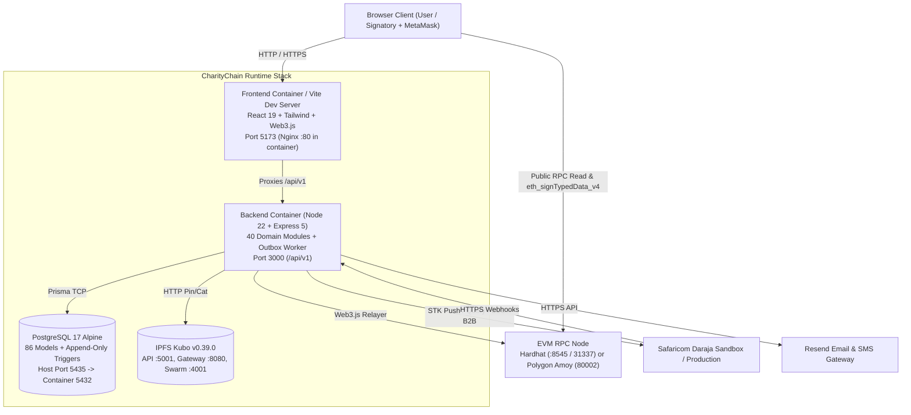

# C4 Level 2: Runtime Containers

The unified monorepo runs cleanly either natively via `npm run dev` (with Docker Postgres & IPFS) or as a multi-container stack defined in [docker-compose.yml](../../docker-compose.yml).

---

## Container Inventory

| Container / Process | Package / Image | Runtime Ports | Primary Responsibilities | Detailed Breakdown |
| --- | --- | --- | --- | --- |
| **Web Frontend (`frontend`)** | `@charitychain/frontend` (`infrastructure/docker/frontend.Dockerfile` + `nginx.conf`) | `5173` | Serves 9 role-based `.jsx` portals, `.tsx` Sankey tracer, 5-column DAG explorer, `Web3.js` MetaMask EIP-712 signer, and Nginx API proxy. | [Frontend Breakdown](../engineering/frontend-breakdown.md) |
| **HTTP API & Workers (`backend`)** | `@charitychain/backend` (`infrastructure/docker/backend.Dockerfile`) | `3000` | Hosts `/api/v1` REST API, Better-Auth sessions, CSRF/RBAC middleware, M-Pesa/Bank adapters, FIFO engine, R01–R20 forensics, simulator, and async outbox relay. | [Backend Breakdown](../engineering/backend-breakdown.md) |
| **Database (`postgres`)** | `postgres:17-alpine` (`@charitychain/database`) | `5435` (host) / `5432` | Stores all 86 Prisma models, executes append-only `BEFORE UPDATE OR DELETE` SQL triggers, and runs initial migrations/seeds via `bootstrap`. | [Data Model](../database/data-model.md) |
| **Evidence Store (`ipfs`)** | `ipfs/kubo:v0.39.0` | `4001`, `5001`, `8080` | Content-addressed storage for AES-256-GCM encrypted disbursement/donation evidence CIDs. | [Audit Anchoring](../blockchain/audit-anchoring.md) |
| **Blockchain & Oracles (`blockchain`)** | `@charitychain/blockchain` (Hardhat 3 / Polygon Amoy) | `8545` (local) / Amoy | Executes immutable notarization contracts (`DonationLedger`, `CaseWorkflow`, `PeriodAnchor`, `EvidenceRegistry`, `SignatoryRegistry`, `CharityChainAccess`, `ChainlinkFxAndAutomation`). | [Smart Contracts](../blockchain/contracts.md) |
