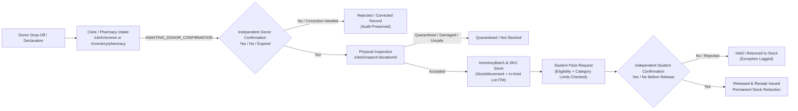

# Physical-Goods Flow Architecture

Campus hospital pharmacy drop-offs (`PHARMACY_CUSTODIAN`) and desk drop-offs (`CLERK`) pass through mandatory independent two-party confirmations and inspection gates before affecting available inventory stock (`FR-INT-08`, `FR-FLOW-05`, `R15`).

---

## 1. End-to-End Physical Intake & Distribution Flow

---

## 2. Key Controls & Segregation Invariants

1. **No Unconfirmed Stock Entry (`FR-INT-08`):** Neither a donor's pre-declaration on `/donor/goods` nor a clerk's desk receipt creates available inventory. Both the clerk entry and an **independent donor confirmation** (with inspection acceptance) are required before stock enters `InventoryBatch`.
2. **Physical Cash Separation:** Cash dropped physically (`PhysicalCashDeposit`) enters `Donor Confirmed -> Cash Held -> Deposit Pending -> Deposit Matched -> Reconciled` and counts toward pool funds only once matched to a central-account bank deposit.
3. **Mobile-First Pharmacy Channel (`Channel.IN_KIND`, `ITM`):** `/inventory/pharmacy` (`PharmacyItemPage.tsx`) records campus pharmacy donations (`POST /api/v1/donations/items`) anchored to `DonationLedger.sol` using currency `"ITM"` and item count as `amountMinor`.
4. **Controlled Allowances & Independent Student Handover:** Goods collection (`GoodsCollectionPolicy`, `goodsCollections.service.js`) validates per-category/total limits and time-bounded reservations; the clerk **cannot** bypass limits or submit confirmation on the student's behalf.
5. **Shrinkage Forensics (`R15`):** Any variance where issued stock exceeds accepted stock or physical stock counts diverge triggers forensic rule `R15` (`inventoryVariance.rule.js`) for supervisor/auditor review.
