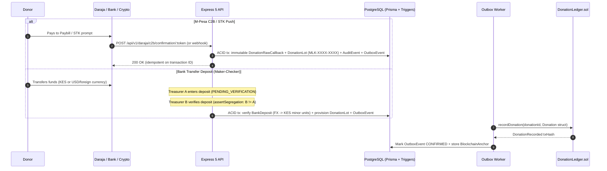
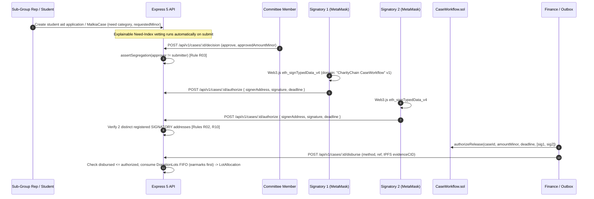

# Monetary Fund-Flow Architecture

CharityChain combines three monetary intake channels (M-Pesa Daraja C2B/STK, maker-checker Bank deposits + CSV reconciliation, and testnet Stablecoins) with strict pooled **FIFO lot accounting**, student Needs Vetting, **2-of-3 EIP-712 signatory release**, and forensic anomaly surveillance.

---

## 1. Intake to Lot Provisioning Sequence

---

## 2. Case Lifecycle, 2-of-3 EIP-712 Signing & FIFO Disbursement

---

## 3. FIFO Lot Allocation & Pool-Drift Invariant

1. **Lot Creation (`FR-FLOW-01`):** Verified inflows become `DonationLot` rows with `initialMinor === remainingMinor`, currency (`KES` minor units), optional earmark, and keyed `donorRef`.
2. **Earmark-First FIFO Consumption (`FR-FLOW-02`):** Disbursements select matching earmarked lots sorted oldest-first before drawing from unrestricted general pool lots, recording exact integer splits in immutable `LotAllocation` (`BEFORE UPDATE OR DELETE` trigger-protected).
3. **Trace & DAG Output (`FR-FLOW-04`):** Public `/trace` reconstructs each donor's Sankey path from lot to anonymized case categories; `/auditor/fund-flow-dag` constructs the complete 5-column PostgreSQL Fund-Flow DAG (`Donors -> Channels/Lots -> Cases -> Approvers -> Disbursements`).
4. **Nightly Pool Invariant (`R16`):** Reconciles `sum(DonationLot.remainingMinor)` against `totalVerifiedInflow - totalDisbursedOutflow` and triggers a Critical alert on any mismatch.
