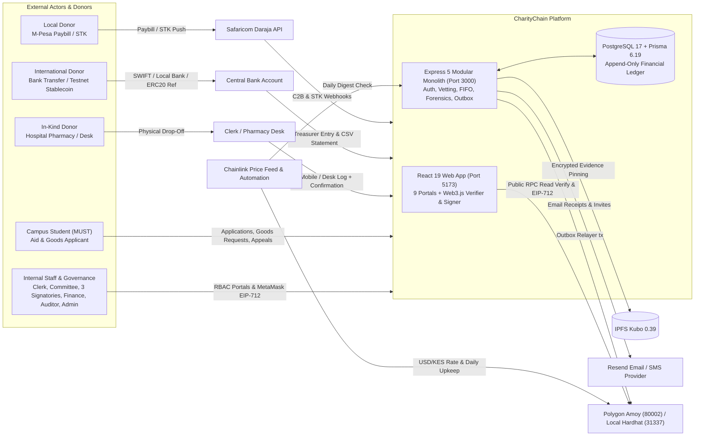

# C4 Level 1: System Context

This view frames CharityChain's external actors, payment/drop-off rails, storage/oracle integrations, and public blockchain boundary as defined in [Product Requirements Document §8.1](../requirements/product-requirements-document.md#81-system-context).

---

## Key Architectural Invariants

1. **Money Never Enters Smart Contracts (`D1`):** Real fiat value stays inside Safaricom M-Pesa and CharityChain's designated bank accounts; Polygon smart contracts act purely as tamper-evident notaries and 2-of-3 multi-signature authorization verifiers.
2. **Zero-Wallet Public Transparency (`D2`):** Donors trace contributions (`MLK-XXXX-XXXX`), verify cryptographic hashes via browser `Web3.js`, claim receipts, and manage recognition consent without creating a blockchain wallet.
3. **Privacy-Preserving Evidence & Identity (`D3`, `D8`):** Beneficiaries and donors are represented on-chain only by domain-separated hashes (`idOf`) and server-keyed HMAC references (`refHash`); uploaded evidence is encrypted with AES-256-GCM before pinning to IPFS.
