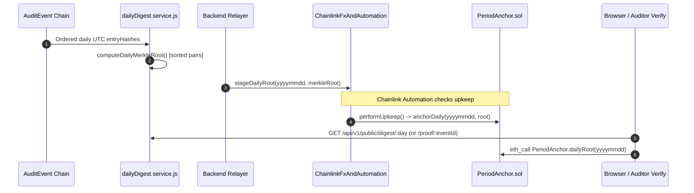

# Audit Anchoring, IPFS Evidence & Chainlink Integration

This document details how off-chain PostgreSQL ledger records, IPFS Kubo encrypted documents, Chainlink feeds/upkeep, and browser `Web3.js` verification stay synchronized without trusting the application database blindly.

---

## 1. Transactional Outbox to Smart Contracts

1. **Atomic Persistence:** Whenever a verified donation (`DonationLot`), case submission/decision/release/disbursement (`MalkiaCase`), or quarterly report (`PeriodReport`) completes in PostgreSQL, the service inserts an `OutboxEvent` row (unique `idempotencyKey`) inside the same database transaction (`D6`).
2. **Idempotent Relay (`outboxProcessor.js`):** Background processing submits the commitment to `DonationLedger`, `CaseWorkflow`, `PeriodAnchor`, or `EvidenceRegistry` and persists `txHash` + block confirmation state (`BlockchainAnchor`).

---

## 2. Encrypted IPFS Evidence (`D8`, `FR-CASE-06`)

* Before pinning to IPFS Kubo (`IPFS_API_URL`, default `http://localhost:5001`), confidential disbursement and student receipts are encrypted via AES-256-GCM (`evidenceEncryption.service.js`).
* PostgreSQL stores the `ipfsCid`, sensitivity tag, and SHA-256 digest of the **plaintext** file (`EvidenceRecord`); `DonationLedger` / `CaseWorkflow` / `EvidenceRegistry` anchor the CID and commitment hash on-chain.
* Authorized internal staff decrypt on read through `GET /api/v1/evidence/*` (`evidence:read`), while public-only items explicitly flagged safe skip encryption.

---

## 3. Daily Merkle Digest & Chainlink FX / Automation

* **Daily Digest Endpoint (`FR-AUD-02`):** `GET /api/v1/public/digest/:day` computes the canonical UTC daily root; `GET /api/v1/public/digest/:day/proof/:eventId` provides individual Merkle inclusion proofs verifiable via `POST /api/v1/public/verify-proof`.
* **Chainlink Automation Hook:** `ChainlinkFxAndAutomation.sol` stages daily roots (`stageDailyRoot`) and executes `checkUpkeep` / `performUpkeep` to write into `PeriodAnchor`; `GET /api/v1/public/chainlink/automation` exposes operational readiness & drift telemetry (`G36`).
* **Chainlink Price Feed (`AggregatorV3Interface`):** `convertUsdCentsToKesMinor` reads the USD/KES feed with `maxStalenessSeconds = 3600` (reverting with `StalePriceFeed` if stale, or serving a governance-configured fallback when `fallbackEnabled` is active on local dev).
* **Independent Browser Verify (`FR-TRACE-03`):** On `/trace`, clicking **Verify Direct on Chain** uses `Web3.js` directly against RPC to recompute `hashDonation` and compare against `DonationLedger.recordHashOf(donationId)`.
