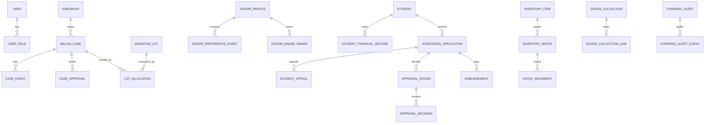

# Database Data Model (`database/prisma/schema.prisma`)

CharityChain uses **PostgreSQL 17** and **Prisma Client 6.19**, unifying the campus operations schema (`71` core models) and the Malkia PRD blockchain/forensic schema (`15` PRD models) into **86 Prisma models** in [schema.prisma](../../database/prisma/schema.prisma).

---

## 1. Entity Relationship Overview (PRD Section 10.1)

---

## 2. Schema Domains (86 Models)

| Domain | Prisma Models | Key Responsibilities |
| --- | --- | --- |
| **Identity, Auth & RBAC (8)** | `User`, `Role`, `Permission`, `UserRole`, `RolePermission`, `Session`, `Account`, `Verification`, `TwoFactor`, `AuditEvent` *(10 tables)* | Better-Auth credentials, 14 roles, 55 permissions, TOTP secrets, and hash-chained `AuditEvent` logs. |
| **Malkia PRD Notary, Cases & Lots (10)** | `Subgroup`, `MalkiaCase`, `CaseEvent`, `CaseApproval`, `DonationLot`, `LotAllocation`, `DonationRawCallback`, `BankDeposit`, `BankStatementLine`, `PeriodReport` | Sub-group case workflow, 2-of-3 EIP-712 approvals, FIFO pooled lots (`MLK-XXXX-XXXX`), bank CSV reconciliation, and deterministic quarterly reports. |
| **Malkia Forensics & Off-Chain Recognition (5)** | `ForensicAlert`, `ForensicAlertEvent`, `ForensicRuleConfig`, `DonorPreferenceEvent`, `DonorBadgeAward` | Rules R01–R20 risk alerts, append-only alert resolution notes, versioned donor public consent, and deterministic badges. |
| **Student, Vetting & Appeals (13)** | `Student`, `AcademicSemester`, `StudentFinancialRecord`, `StudentPayment`, `ExamCalendar`, `StudentAidRecord`, `StudentFinanceBlock`, `StudentAssistanceHistory`, `AssistanceApplication`, `AssistanceApplicationHistory`, `StudentAppeal`, `VettingPolicy`, `VettingRun`, `VettingFactorResult` *(14 tables)* | MUST simulated records (`MUST/SIM/2026/*`), Need-Index explainable vetting, semester duplicate prevention, and student appeals. |
| **Committee Governance & Payouts (6)** | `CommitteeMembership`, `CommitteeMembershipHistory`, `CommitteeConflict`, `ApprovalRound`, `ApprovalDecision`, `Disbursement`, `DisbursementAttempt`, `DisbursementProviderEvent` *(8 tables)* | Quorum membership, conflict-of-interest declarations, M-Pesa B2C/B2B payouts, and provider event logs. |
| **Physical Donations & Inventory (19)** | `PhysicalDonation`, `PhysicalDonationLine`, `PhysicalDonationInspection`, `PhysicalCashDeposit`, `ConfirmationRequest`, `ConfirmationResponse`, `ConfirmationDelivery`, `InventoryCategory`, `InventoryItem`, `InventoryLocation`, `InventoryBatch`, `StockMovement`, `InventoryReservation`, `StockCount`, `StockCountLine`, `GoodsCollectionPolicy`, `GoodsCollection`, `GoodsCollectionLine` *(18 tables)* | Pharmacy/desk physical intake, Yes/No donor/student confirmations, warehouse batches, expiry, stock counts, and collection caps. |
| **Campus Payments, Accounting & Ops (21)** | `DonorProfile`, `MoneyDonation`, `DonationAllocation`, `DonationReceipt`, `PaymentAttempt`, `PaymentProviderEvent`, `RecognitionTier`, `RecognitionHistory`, `RecognizedContribution`, `LedgerAccount`, `LedgerJournal`, `LedgerEntry`, `ReconciliationRun`, `ReconciliationItem`, `EvidenceRecord`, `BlockchainAnchor`, `BlockchainAnchorAttempt`, `ForensicAnomaly`, `ForensicInvestigation`, `Notification`, `NotificationDelivery`, `OutboxEvent` *(22 tables)* | Double-entry internal ledger accounts, M-Pesa/Bank reconciliation runs, AES-GCM evidence metadata, transactional outbox, and anchor attempts. |

---

## 3. Data Conventions

1. **Primary Keys:** UUID strings across transactional and domain records.
2. **Monetary & Item Amounts:** Stored exclusively as integer minor units (`Int` / `BigInt`, e.g., `KES 500.00` = `50000`, physical items = `ITM` count) with zero floating-point arithmetic.
3. **Timestamps:** Stored in UTC (`DateTime`), rendered locally in East Africa Time (`EAT`, UTC+3).
4. **Soft State & Compensations:** Financial tables never destructively mutate finalized inflows or disbursements; corrections create linked compensating records.
